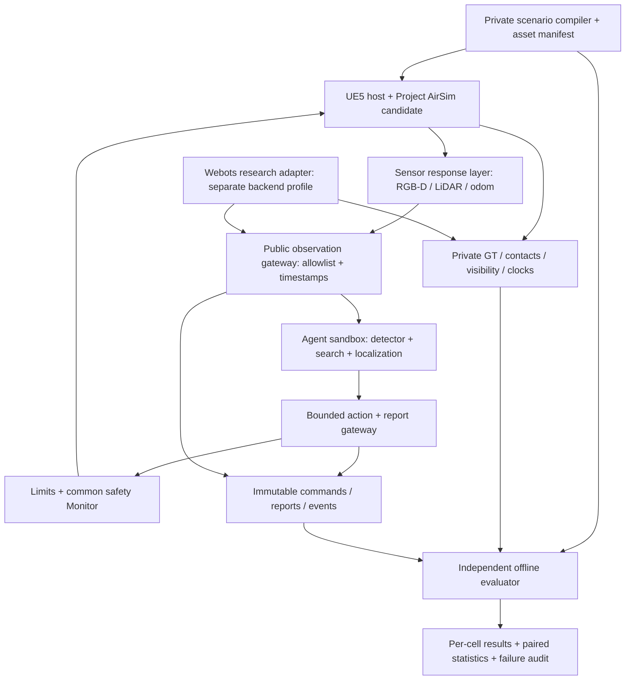

# Kiến trúc benchmark UE5 chính và Webots đối chứng

**DESIGN, 2026-11-25.** Tài liệu định nghĩa ranh giới cần triển khai; không mô tả một bridge UE5 đã chạy. Existing code và kết quả được dẫn riêng theo phạm vi đã có.

## 1. Thành phần repository tái sử dụng

Đã đọc [Webots S0](../simulator-feasibility.md), [S1](../webots-s1-audit.md), [S2](../webots-s2-audit.md), [Godot S0](../godot-s0-feasibility.md), [T1 spec](../benchmark-t1-spec.md) và các interface/source liên quan. Không port toàn bộ repository; giữ imports/API core cho baseline khi hợp model.

| Thành phần | Bằng chứng / giới hạn hiện tại | Tái sử dụng cho UE5 |
| --- | --- | --- |
| [SearchMission](../../test%20version/search_core_ros1.py), [Navigator/Costmap](../../test%20version/navigation_core_ros1.py) | S2 import core trực tiếp và chạy 7 scenarios; planner đồng bộ nghiệm thu, async repeat timing FAIL | Baseline B3, giữ algorithm/config hashes; detection mới cấp target estimate, không recognition oracle. Không nhận đa-target association đã có sẵn |
| [Collision Monitor](../../test%20version/collision_monitor_ros1.py) | S2 kiểm invalid/stale, STOP/SLOWDOWN và actual zero; bounds/scan profile riêng fixture | Common safety cho modular baselines, cấu hình lại footprint/scan/extrinsics; logs raw→limited→checked→applied. Không gọi là safety-certified cho robot thật |
| [S2 adapter](../../experiments/webots_s2/adapter.py), [runtime](../../experiments/webots_s2/runtime.py) | Pose Supervisor ideal; oracle camera-relative target; epoch/freshness/new_episode/worker cleanup đã có | Reuse design, transforms/helpers sau independent tests. Observation dataclass hiện chỉ phục vụ S2, không mở nó bằng GT fields để tiện UE |
| [S2 geometry/audit](../../experiments/webots_s2/geometry.py), [calibration](../../experiments/webots_s2/controllers/s2_calibrate/s2_calibrate.py) | SAT footprint, contacts/hold, axis/scan tests trong primitive scenes; LiDAR có seam negative bias ~0,119 m | Calibration test patterns, không mang tolerances hoặc exact ranges sang renderer khác |
| [T1 schema](../../test%20version/benchmark/schema.py), [journal](../../test%20version/benchmark/journal.py), [paired](../../test%20version/benchmark/paired.py), [metrics](../../test%20version/benchmark/metrics.py) | Strict IDs/finite/path checks, run contracts, locks/journal và paired attempts; T1 oracle geometry, single person, flat integration | Reuse provenance/attempt/atomic-write principles. Không sửa T1 version/evaluator để chứa 3D SAR; journal hashes không ngăn hostile agent đọc GT |
| [T1 evaluator](../../test%20version/benchmark/evaluator.py) | Independent from policy, xác nhận một report từ oracle observation | Boundary pattern, không reuse semantics/one-target matcher cho multi-victim. `oracle.py` không nằm trong main UE policy process |
| [Godot bridge](../../experiments/godot_s0/bridge.py), [simulator](../../experiments/godot_s0/simulator.gd) | TCP ID/epoch/validation/reconnect, RGB bytes và headless-invalid behavior; logical clock chỉ phù hợp static fixture, không pause cả engine | Bài học transport/validity/reset; không port logical stepping sang Chaos và gọi deterministic global step |
| [Production robot](../../jetauto_find_object.py), [avoidance](../../obstacle_avoidance.py) | YOLO/Astra/scan/Mecanum integration, config và driver topics | Detector/localizer reference và validation data interface; không import module có ROS/device side effects vào benchmark harness |

Scientific reuse quan trọng: independent evaluator vs policy; bounded no-target experiment khác proof of absence; frame/time calibration trước mission; retain failed attempts; common-seed pairs với immutable contracts. Những nguyên tắc này bền vững hơn hình học/chỉ số success của fixture S0.

## 2. Trust và data flow



Mermaid là design diagram, không phải deployed topology. Một experiment chọn đúng **một** backend và profile. UE5 và Webots không cùng tạo observations cho một episode; hai mũi tên ở sơ đồ là các triển khai thay thế cùng hợp đồng public.

Trusted host nắm actor state, raw depth/masks/navmesh, asset/scene IDs, fault seeds. Response layer có quyền raw sensor và calibration, chỉ xuất simulated measurement; không thêm annotation vào observation. Ground-truth recorder có read-only access scene và ghi vào namespace riêng, evaluator không sửa world/policy. Agent không có raw upstream client hoặc engine port; facade không proxy command strings tùy ý.

Agent process/container user chỉ thấy schema public, model/training inputs được phép và delivered packets. Tắt file mounts/network routes tới UE console, UnrealCV reflection, actor queries, segmentation, navmesh/waypoint GT, private logs và checkpoints của evaluator. Không gửi `info`/reward nguyên của Gym wrapper vào agent. Allowlist serialize type/shape và reject unknown fields, không chỉ blacklist `target_pose`. Test adversarial request cho privileged API và canary GT fields. Python module separation trong cùng process chưa là security boundary.

Public report ACK chỉ xác nhận sequence/schema đã nhận; kết quả matching giữ tới cuối evaluation. During debug có privileged tools nhưng run manifest phải ghi `diagnostic=true`; không thể đưa debug run vào main table.

## 3. Backend interface đề xuất

Đây là **interface sketch**, không là phương thức Project AirSim đã tồn tại nguyên tên:

```python
class BenchmarkBackend:
    def capabilities(self): ...  # engine, sensors, timing, actuation, privilege model
    def reset(self, private_scenario, seed_streams): ...  # new epoch, zero, flush
    def advance(self, checked_action, physics_ticks): ...  # exact barrier or reject
    def read_measurements(self, epoch): ...  # capture/delivery stamps, valid flags
    def record_truth(self, epoch): ...  # private channel only
    def stop(self): ...
    def close(self): ...
```

Harness nhận capability negotiation trước run. Thiếu metric depth, frame transform, contact channel hoặc controllable clock → fail preflight cho main track, không fabricate values. Deployment mode có thể dùng `advance_until(deadline)` khác capability; không gọi step mode đã đạt nếu chỉ có sleep real time.

Adapter `B3CorePolicy` nhận estimated pose/ranges/detections; chuyển detections cùng capture timestamp sang odom/episode frame; đa-victim track memory/report manager nằm ngoài SearchMission một-target hiện tại. Short-term target choice do policy, không evaluator chọn gần nhất theo GT. SearchMission được tái tạo/close mỗi episode; `Navigator.reset()` riêng không đủ để đảm bảo planner futures cũ biến mất. Shared safety cập nhật scan đúng stamp trước command, không update giả khi missing.

## 4. Frames, units và transforms

Canonical: mét/radian/nanosecond integer; episode ENU-like right-handed có x theo hướng robot lúc start, y trái, z lên; base FLU; RGB optical x phải/y xuống/z trước. Episode origin là projection chassis start xuống mặt phẳng sàn, không phải camera. Global geo ENU nếu dùng về sau cần transform explicit; không gọi frame khởi đầu là tọa độ GPS thật.

UE native x-forward/y-right/z-up, centimetres/degree; chọn canonical world x-forward/y-left/z-up: `pC = diag(1,-1,1)*pUE/100`. Rotation đổi bằng `RC = S*RUE*S` với S=diag(1,−1,1), không tự lật một quaternion component theo trực giác. Test +90° rotations và vector landmarks. Project AirSim thường dùng NED/FRD APIs: map world vector `(N,E,D)` → `(E,N,−D)` nếu canonical global ENU; base `(F,R,D)` → `(F,−R,−D)`. Sau đó áp initial-origin/yaw transform tới episode frame. **Không áp UE cm conversion lần hai lên API đã trả mét.** Đọc metadata từng API, kiểm empirically.

Depth unprojection optical: `p=[(u−cx)Z/fx,(v−cy)Z/fy,Z]`; nếu input là perspective range r thì `Z=r/sqrt(1+x_norm²+y_norm²)`. Dùng native depth K và depth→RGB calibration khi registration; report transform `T_episode_base_est(t_capture)*T_base_optical*p`. GT evaluator dùng independent measured actor anchor ở actual world mapped qua **GT initial frame**, không dùng estimated transform bị drift để tự triệt tiêu error.

LiDAR bins canonical CCW từ +x; extrinsic đúng một lần; range min/max, no-return và invalid khác nhau. Backend angular scan order/timing khác phải chuyển và test bằng wall/pole trước/trái/phải/seam. Bỏ segmentation IDs trong LiDAR reports trước public serialization, kể cả API có sẵn ID. Quy tắc này quan trọng với Project AirSim sensor data chứa auxiliary segmentation metadata. [LiDAR format docs](https://iamaisim.github.io/ProjectAirSim/sensors/lidar.html).

## 5. Lifecycle, clock và error handling

Reset transaction: safe zero → dừng/thu hồi policy workers → discard queued commands/reports → restore scene/controller velocities/RNG → increment epoch → reset clock/sensor response/camera history → settle/warmup → validate GT start và contacts → flush sensor queues → first coherent observation. Error ở bất kỳ bước nào → no new episode, zero, ghi error; không acknowledge reset thành công rồi sửa state sau.

Mọi packet/command/report có epoch và monotonic sequence. Capture clock, delivery clock, simulation clock, wall monotonic không hoán đổi. Agent compute pause phải pause **toàn world gồm Chaos, actors, animation và sensor response state**, không chỉ logical tick. Native UGV Project AirSim engine-driven clock không mặc nhiên hỗ trợ SimClock pause, xem [clock docs](https://iamaisim.github.io/ProjectAirSim/config_scene.html). Host-owned stepping/barrier là phần integration còn thiếu cần thực nghiệm.

Sensor timeout/invalid → Monitor invalidate và zero theo configured gate, timestamp buffer cũ giữ nguyên. Camera absence do sensor fault không giống no detection của frame valid. Exception có traceback/failure outcome, không tiếp tục lệnh cũ. Engine exit/crash không lấy thành công cuối log của epoch trước. Runner chỉ terminate cây process tự tạo và giữ logs, không đóng ứng dụng Webots/Godot của người dùng.

## 6. Webots và T1 trong kiến trúc mới

Giữ nguyên `experiments/webots_s2/` như evidence baseline lịch sử. New Webots research adapter khi cần nằm riêng, dùng cùng public task/report contract nhưng **backend-specific sensor/actuation manifest**. Không bật camera recognition làm main detector; có thể chạy oracle track có nhãn. S2 hiện chưa có empirical depth/odom và target report protocol mới nên không gọi nó đã chạy S3.

Webots dùng để debug geometry/frame/freshness/safety cheaply, thử paired seeds và nghiên cứu sensitivity theo backend. So sánh cùng calibrated parameters và robot intent chỉ là **matched task specification**; collision geometry/renderers/solver/actuation/odom models vẫn khác. Không pool UE5 và Webots episode scores thành một SR chung, không dùng Webots PASS chứng minh UE physics đúng. Report backend-stratified Δ và consistency, công khai mismatch sensor/model. T1 tiếp tục là 2D oracle research harness t1-0.2, không đổi metrics/fixtures hoặc tái ghi bảng T1 như UE results.

Godot S0 giữ như feasibility artifact/transport reference, không mở backend thứ ba trong paper v0. Previous recommendation Webots-main trong audit S0 là quyết định lịch sử theo mục tiêu/cấu hình cũ; S3 đề xuất UE5-main theo mục tiêu nghiên cứu mới, giữ nguyên audit cũ để truy vết.

## 7. Cấu trúc code sau khi có hạ tầng

Layout dự kiến, **chưa tạo trong S3**: `experiments/ue5_s3/` chứa backend runner, Unreal project/plugin và calibration fixtures; package `sar_benchmark/` riêng chứa contracts, public gateway, reporter, independent evaluator và statistics; `runs/` ignored chứa immutable evidence; `assets/manifest` chứa metadata/download recipe, không tự vendor proprietary files. Chỉ tách module khi implementation cần, không copy T1 package nguyên khối.

Dependency boundary: core ROS-free imports được phép; production main/driver/SSH/start scripts không được gọi từ experiment. UE C++ owns tick/contact/sensor capture; Python owns policy, experiment schedule và offline analysis; bridge không quyết định TP/FP. CI không có graphics chạy contract/evaluator/property tests; graphics worker chạy actual RGB/depth/control/reset smoke và small closed-loop traces. Mock/unit pass và compile success được ghi đúng phạm vi, không là simulation evidence.

Rollback thực tế của S3: các thay đổi chỉ dưới `docs/research/`; có thể bỏ riêng nhóm file mới sau khi review mà không chạm baseline code. Khi triển khai sau, dùng feature branch/run directory riêng, không save end pose đè canonical worlds và không nâng dependencies của production để cài framework thử nghiệm.
