# S4 — native runtime visual QA, 2026-11-26

Repository `innguyen/Robotic`, `feat/benchmark`, tiếp tục từ `382fbb08`. Tất cả hình trong báo cáo là UE runtime PNG hoặc visualization từ native depth/mask. Không dùng ảnh AI, concept art hoặc ảnh asset preview để thay runtime evidence. [Audit S4](s4-audit.md), [asset inventory/license](../../experiments/ue5_s4/assets/environment/README.md), [human provenance](../../experiments/ue5_s4/assets/anatomy/README.md).

## Bản hiện tại sau khi kiểm tọa độ trong UE

Bảng dùng cùng góc nhìn và độ phân giải 640×480 cho mỗi cặp. Ở indoor, phần mái còn đứng che robot trong overview phía nam. Camera gắn trên robot cho thấy tủ điện sát vách vỡ và lối đi bên phải. Ở outdoor, vật cản bê tông chắn phần thân nạn nhân, phía sau là kệ hàng và dãy cửa cuốn. [Camera poses, RGB, optical depth và mask của từng ảnh](evidence/s4-site/registered-poses/run-frames/index.json)

| Cảnh và camera | Trước | Bản hiện tại |
| --- | --- | --- |
| Indoor, overview | 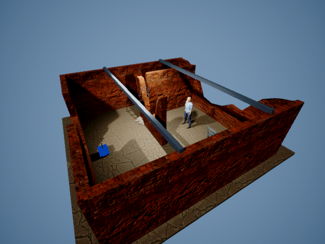 | 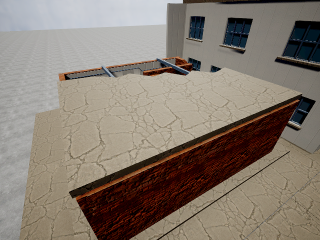 |
| Indoor, RGB robot | 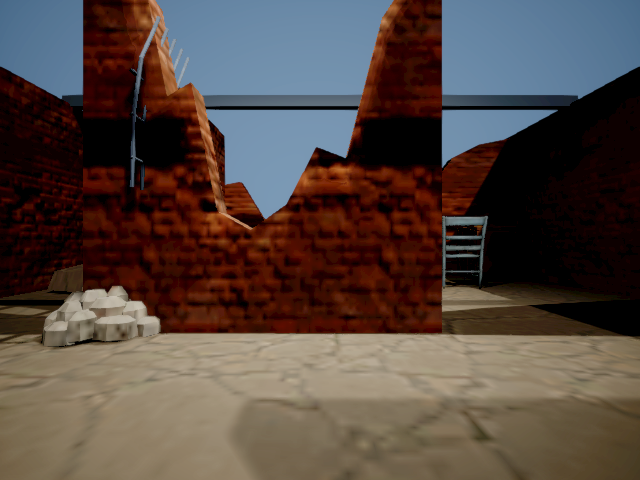 | 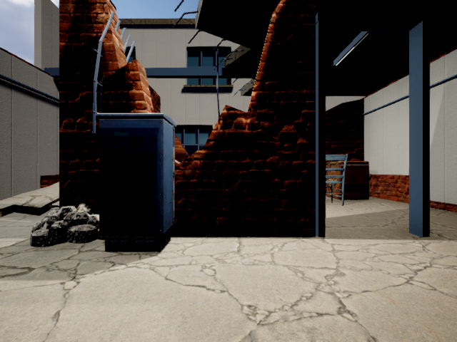 |
| Outdoor, overview | 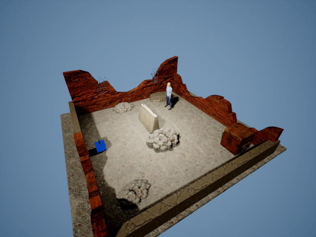 | 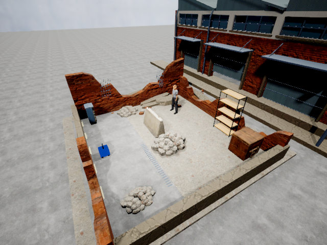 |
| Outdoor, RGB robot | 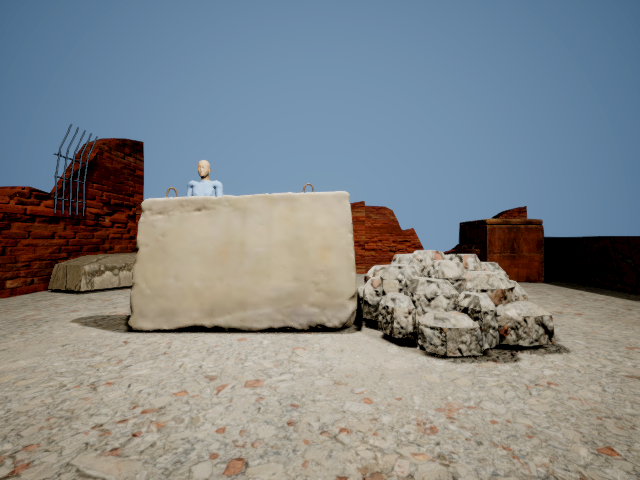 | 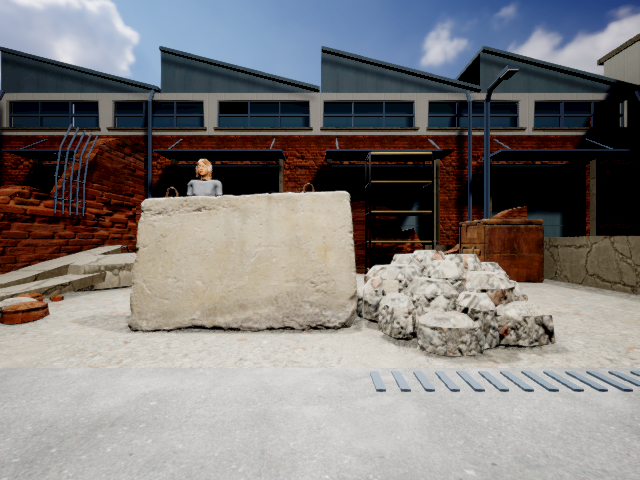 |

Ở góc kiểm riêng, indoor clean ghi một box cho từng tư thế. Khi giảm sáng, YOLO bỏ sót người ngồi và nằm dù mask vẫn có 15.181 và 24.890 pixel. Outdoor có một box ở từng góc kiểm. Trong sáu episode bốn tick, chỉ outdoor standing có report đúng (XY 5,2 cm). Có thể đối chiếu trực tiếp từng PNG với mask và depth native. [Tư thế ngồi, low-light](evidence/s4-site/registered-poses/run-frames/qa-03-indoor-seated-P1-native.png), [mask](evidence/s4-site/registered-poses/run-frames/qa-03-indoor-seated-P1-v0-visible.png), [depth mm](evidence/s4-site/registered-poses/run-frames/qa-03-indoor-seated-P1-depth-mm.png), [scored metrics](evidence/s4-site/registered-poses/run-summary.json)

Trong sáu episode ngắn, UE ghi 9,45 callback/s indoor và 9,53 callback/s outdoor với cap 10. Private commit lấy mẫu cao nhất trong từng cảnh là 3,24 và 3,29 GiB. Đỉnh working set của toàn tiến trình là 1,56 GiB. Mẫu một layout mỗi loại, với một avatar, còn hạn chế đối với đánh giá độ chân thực và khả năng tổng quát. [Phép đo theo cảnh](evidence/s4-site/registered-poses/performance.json), [native calibration](evidence/s4-site/registered-poses/run/calibration.json), [audit độc lập](evidence/s4-site/registered-poses/run-final-audit.json)

### Tìm kiếm 90 giây trên bản hiện tại

Từ phía bắc có thể nhìn qua cạnh mái vỡ xuống hai khoang phòng. Đây là ảnh của camera QA riêng ở độ phân giải chạy search 320×240. Cả hai layout giữ nguyên góc overview chính trong bảng đối chiếu phía trên. [Overview qua mái vỡ](evidence/s4-site/registered-search/run-frames/overview-breach.png), [tọa độ camera](evidence/s4-site/registered-search/run-frames/overview-breach-camera.json)

| Cảnh / baseline | Quãng đường | TP / FP | Report đúng đầu / sai số XY | Kết thúc |
| --- | ---: | ---: | --- | --- |
| Indoor / frontier | 3,728 m | 1 / 0 | 18 s / 0,075 m | FINISH an toàn |
| Indoor / core | 1,958 m | 0 / 0 | Không có report đúng | FINISH an toàn |
| Outdoor / frontier | 2,755 m | 1 / 0 | 0,5 s / 0,068 m | SAFETY_ABORT |
| Outdoor / core | 2,790 m | 1 / 0 | 0,5 s / 0,067 m | SAFETY_ABORT |

Indoor frontier xuất phát với 0 pixel nạn nhân. Nạn nhân bắt đầu nhìn thấy ở tick 22. Khi đủ hai frame để báo đúng (tick 34 và 36), robot đã dịch chuyển 0,863 m. Outdoor xuất phát với 201 pixel nạn nhân phía trên dải phân cách. Hai episode unsafe đều có safe recall 0. [Tính từ raw path và ledger](evidence/s4-site/search-paths.json), [đối chiếu đủ bốn scene/method và offline audit](evidence/s4-site/registered-search-schedule-audit.json)

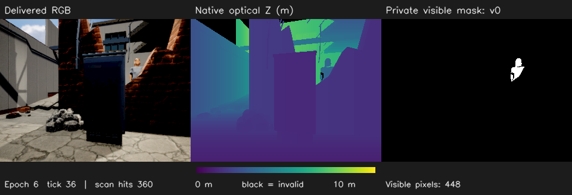

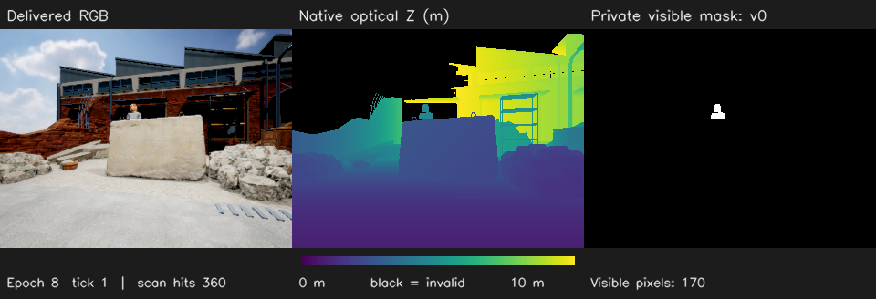

Tốc độ UE trong cửa sổ các episode đạt 9,10 callback/s indoor, 9,18 outdoor, giới hạn 10 callback/s. Private commit lấy mẫu trong hai cửa sổ đạt 2,88 và 2,84 GiB. Đỉnh working set của tiến trình là 1,72 GiB. Video phát 2 fps theo đồng hồ tác vụ và có hash của từng frame nguồn trong sidecar. [Phép đo](evidence/s4-site/registered-search/performance.json), [source raw](evidence/s4-site/registered-search/run/archive-provenance.json)

| Camera robot, video liên tục | Frontier | Core |
| --- | --- | --- |
| Indoor | [180 frame](evidence/s4-site/registered-search/e000-video/robot.avi) | [180 frame](evidence/s4-site/registered-search/e001-video-complete/robot.avi) |
| Outdoor | [115 frame](evidence/s4-site/registered-search/e002-video/robot.avi) | [134 frame](evidence/s4-site/registered-search/e003-video/robot.avi) |

Cả bốn video đã được giải mã lại và kiểm thứ tự theo journal. Thư mục `e001-video` là lần xuất video bị ngắt. Video indoor core trong bảng trỏ đến bản xuất lại đã xác minh. Hai video outdoor kết thúc ngay trước trạng thái terminal riêng của evaluator.

## Lịch sử nâng cấp office wing và loading depot

Các ảnh dưới đây là PNG từ UE 5.6.1 trên Iris Xe. Cùng camera overview và cùng điểm xuất phát trong mỗi cặp cho phép xem thay đổi về tỷ lệ, ánh sáng và vật cản. Overview nhìn xuyên phần mái đã vỡ. Chỉ RGB từ camera gắn trên robot được giao cho policy.

| Cảnh | Trước, revision 1 | Revision 2 sau khi sửa ánh sáng, 640×480 |
| --- | --- | --- |
| Văn phòng, overview |  | 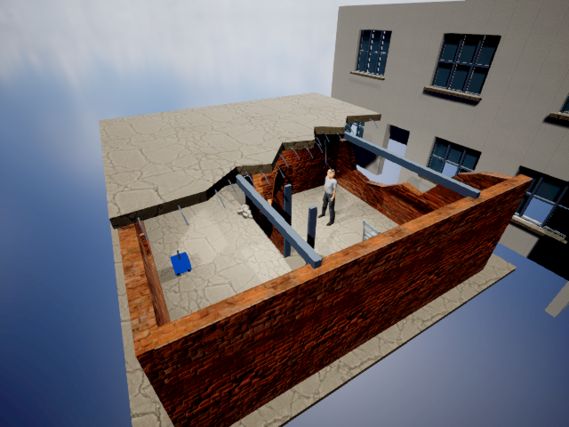 |
| Văn phòng, camera robot |  | 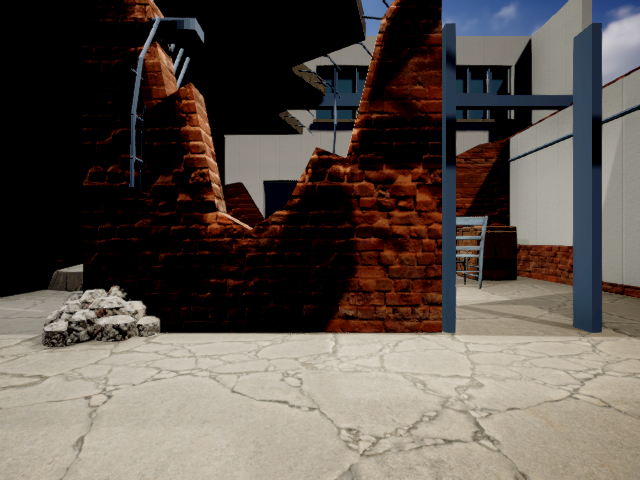 |
| Khu giao nhận, overview |  | 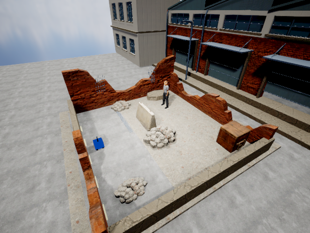 |
| Khu giao nhận, camera robot |  | 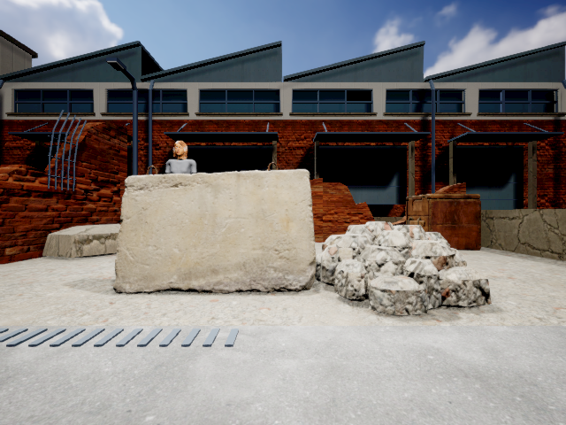 |

Mái có cạnh gãy và cốt thép lộ ra ngoài. Qua lỗ thủng trong vách, robot nhìn thấy cửa sổ của khối nhà phía sau. Camera ngoài sân thấy mái răng cưa, cửa cuốn và mái che của nhà kho. Ở lượt 640×480 này, overview indoor còn lộ mép nền trước nhà phụ. Lượt tìm kiếm kế tiếp dùng nền mở rộng, khối phụ có mái kín và các mảng tường đổ. Mô hình còn lặp vật liệu gạch và dùng một danh tính người. [Asset inventory](../../experiments/ue5_s4/assets/environment/README.md)

| Góc kiểm tư thế, indoor clean | Native RGB | Depth-tested visibility |
| --- | --- | --- |
| Đứng | 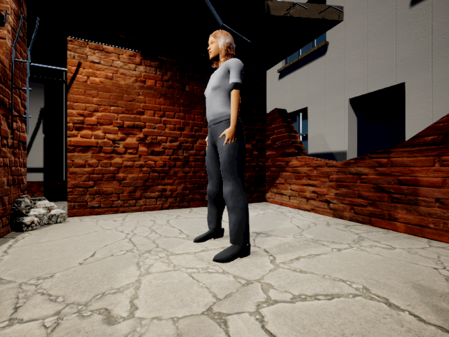 | 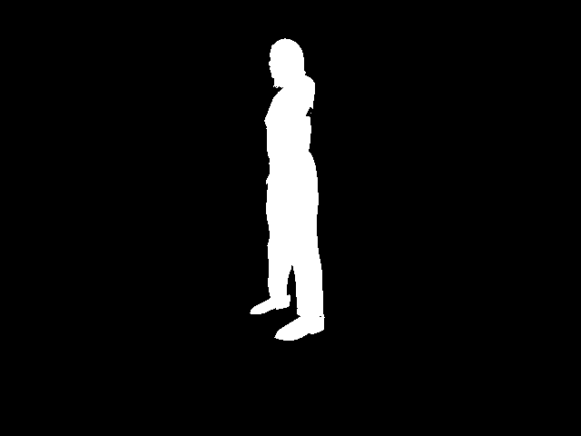 |
| Ngồi | 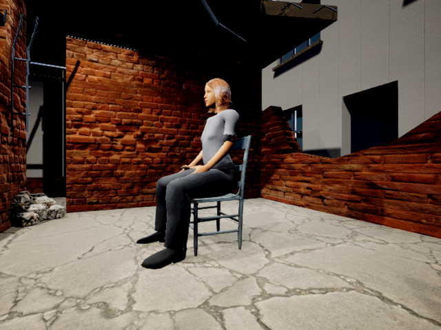 | 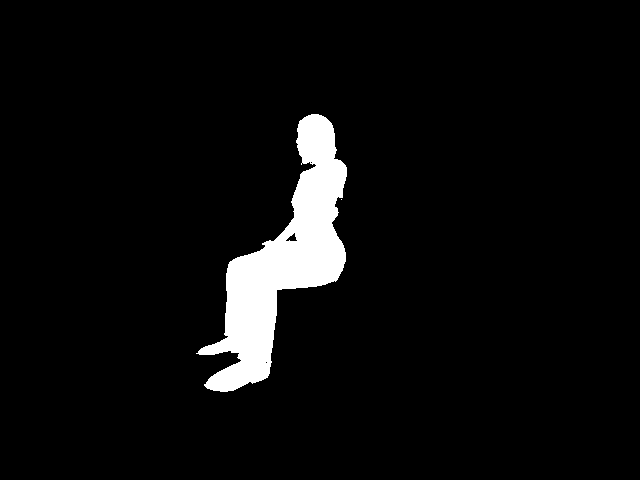 |
| Nằm sấp | 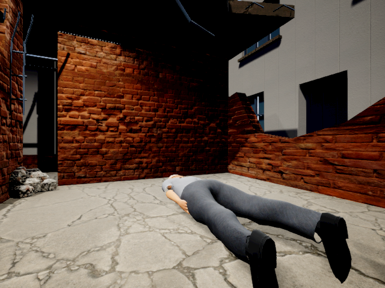 | 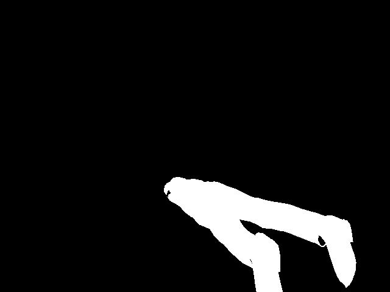 |

Mỗi tổ hợp cảnh, tư thế và ánh sáng qua ba reset khớp RGB/depth/scan. Tại góc kiểm riêng, YOLO trả về một box cho người ngồi indoor clean và hai box khi giảm sáng. Ở hai góc nằm indoor, người có 24.890 pixel nhìn thấy nhưng detector trả về 0 box. Trong sáu episode bốn tick, chỉ outdoor standing có report đúng. Các ảnh, box, optical depth tính bằng mm, masks và góc camera đều nằm trong gallery. [Gallery và kết quả từng frame](evidence/s4-site/lighting/six-poses-frames/index.json), [metrics](evidence/s4-site/lighting/six-poses-summary.json)

Trong cửa sổ sáu episode trên, callback UE đạt 9,52/s indoor và 9,42/s outdoor. Mức private commit lấy mẫu trong các cửa sổ tương ứng là 3,04 và 3,05 GiB. Cả quá trình UE đạt đỉnh working set 1,67 GiB. Tần số callback bao gồm chờ inference, render và trao đổi packet. [Phép đo riêng từng cảnh](evidence/s4-site/lighting/scene-performance.json)

Lượt đầu dùng shader bầu trời bị lỗi và không qua kiểm reset indoor seated clean. Giữ nguyên đầy đủ các ảnh và kết luận FAIL. Hai video revision 1 phát ở 2 frame/s theo task clock và bao gồm cả lượt dừng do va chạm. [Lượt render lỗi](evidence/s4-site/first-render/visual-01-final-audit.json), [video indoor v1](evidence/s4-site/before-indoor-video/robot.avi), [video outdoor v1](evidence/s4-site/before-outdoor-video/robot.avi)

### Lượt active search phát hiện lỗi bố trí mesh

Trước khi sửa trục Y của importer, frontier bắt đầu indoor với nạn nhân bị che, đi 2,555 m và định vị đúng ở giây 18 (XY 0,066 m). Khi quay ở giây 37, chassis chạm collision của `masonry_heap`. Outdoor đi 2,755 m, có một TP, XY 0,060 m và dừng vì tiếp xúc ở giây 57,5. Cả hai có 0 FP và safe recall 0. Calibration sau hai episode bị ngắt khi pose QA indoor rơi vào debris. UE exit 0. Hai video kết thúc ở frame cuối thực sự giao cho policy. [Video indoor, 74 frame](evidence/s4-site/after-indoor-video/robot.avi), [video outdoor, 115 frame](evidence/s4-site/after-outdoor-video/robot.avi), [audit FAIL](evidence/s4-site/frontier/search-final-audit.json)

| Evidence từ lượt này | Indoor | Outdoor |
| --- | --- | --- |
| Overview | 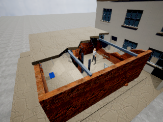 | 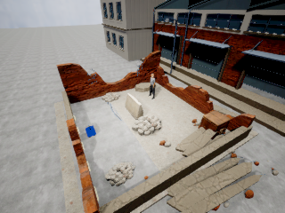 |
| RGB tại report đúng | 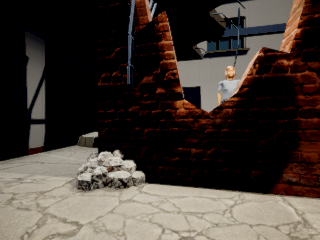 | 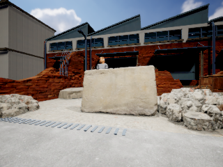 |

## So sánh trước đây giữa fixtures và revision 1

Before là legacy rescue fixtures với Cesium Man. After là hai asset-based layouts có topology khác: damaged building hai khoang và semi-outdoor service courtyard. Đây là visual engineering comparison; vị trí target, geometry, lighting và avatar cùng thay đổi, nên không dùng chênh lệch detection để suy ra causal improvement hoặc generalization. Camera overview cuối dùng cùng recipe `[-.3, -5.8, 5.3] → [3, 0, .7]`, 640×480, D3D11 standard raster. Overview là private QA, không phải observation của agent.

## Indoor damaged building

Before — overview UE thật:

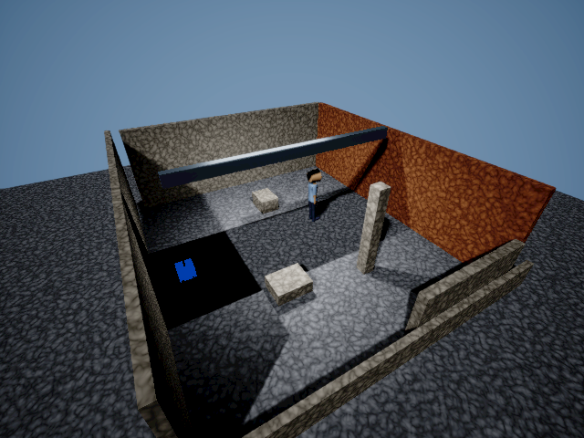

After — overview UE thật:

Before — RGB camera robot, tick 0:

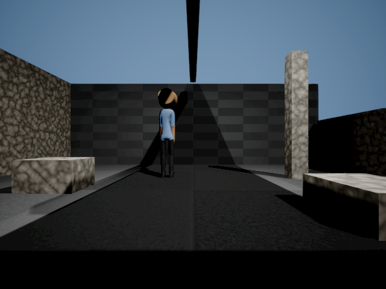

After — RGB camera robot, tick 0; victim bị partition che nên không được diễn giải như detector miss trên một victim nhìn rõ:

Masonry dùng external base color/DX normal/roughness; fractured structural meshes có thickness và silhouette bị vỡ, exposed reinforcement, joists, rubble piles, fallen slab, worn chair và crate. Legacy cubes vẫn là fixtures riêng. Các góc hốc concave và imported convex collision không phải destruction/contact simulation.

## Semi-outdoor disaster courtyard

Before — overview UE thật:

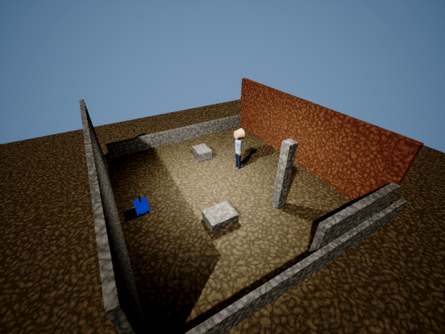

After — overview UE thật; sân mở, loading island/barrier và đường vòng khác topology indoor:

Before và after RGB camera robot, tick 0:

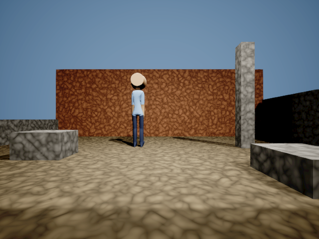

High-quality source props gồm concrete barrier có chipped surface/rebar, worn wooden chair và riveted crate; structural meshes/rubble là original authored geometry. Texture source 1K, không có HDRI/Lumen/Nanite acceptance, khói, cháy, dynamic collapse hay weather transport. Scene composition vẫn là compact development set, chưa phải scanned disaster site.

## Anatomy, pose, mask và lighting

MakeHuman CC0 base/rig/weights thay avatar Cesium trong asset scenes: 13.380 vertices, 26.756 triangles, standing height 1,75 m, facial/hand/foot anatomy, original work clothing và lowered seated arms. Body origin là posed torso joint; metadata ghi exact mesh hash, torso height và bounds. Regression kiểm lower-Z + torso-height = 0; UE isolation mask dùng chính actor mesh đã import. Public localizer không nhận anchor/joint/visibility truth.

Các ảnh sau là **privileged calibration viewpoints**, không phải policy captures, không được tính thành scored reports:

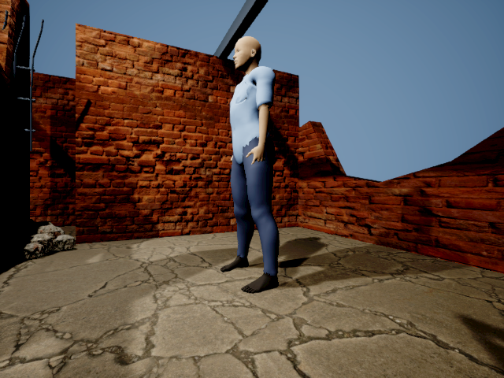

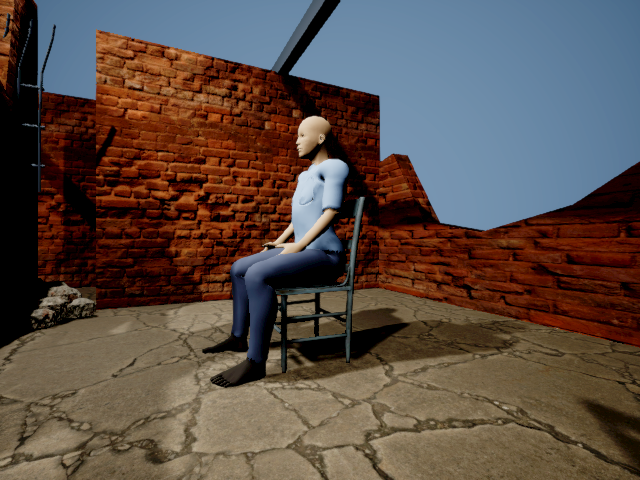

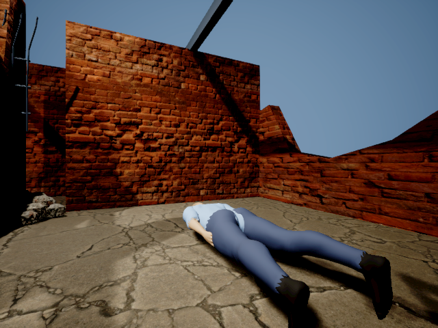

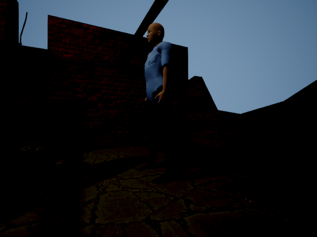

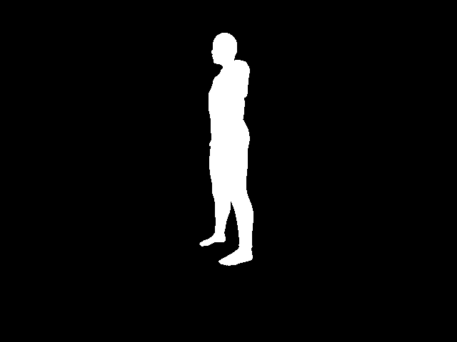

Depth artifacts `*-depth-mm.png` là optical Z đo từ EXR, uint16 mm, 0 = invalid; PNG gốc và EXR lossless vẫn trong raw host stream. Binary masks là visualization từ isolated/full-scene depth agreement. [Frame index](evidence/s4-assets/final-poses-frames/index.json) ghi role, epoch/tick, world camera pose, PNG hashes, visible pixels và offline detector outputs.

Một directional sun và một rect fill thay hai directional lights. Registration giữ cố định giữa resets. Calibration chạy 2 environments × 3 poses × clean/low-light, mỗi tổ hợp ba resets với RGB/depth/scan hashes khớp và visible mask ≥25 pixels. Không nới RGB tolerance. Một neutral avatar chưa là photorealistic victim: chưa có scanned skin/hair, identity diversity, detailed garments/injury corpus hoặc cloth/contact dynamics. Seated/prone detector coverage còn hạn chế; không suy detection acceptance từ anatomy hoặc visible masks.

## Failed/partial evidence và acceptance

Ngày 26-11-2026, lượt legacy riêng `s4-legacy-pilot-completion-01` hoàn tất 54/54 episode, đạt calibration 15/15 và offline audit PASS. Hai cảnh asset-based có bộ nghiệm thu riêng ở đầu báo cáo. Các trạng thái FAIL và partial dưới đây thuộc các lượt lịch sử tương ứng. [Biên bản pilot cuối](evidence/s4-site/legacy-pilot-completion-01/acceptance.json)

[Frozen pilot inspection](evidence/s4-assets/frozen-pilot-partial/partial-inspection.json): 41 completed ledgers recompute khớp, nhưng hai gzip stream bị cắt, không engine-exit/calibration/results/inventory cuối. **Không nghiệm thu 54 episodes.** [Active-search cũ](evidence/s4-assets/previous-active-search-audit.json) có clean exit và 540 packets nhưng không requested calibration, cả ba methods 0 TP.

Mọi attempt mới, kể cả startup fail, import bị cháy sáng/UV kéo giãn, open-boundary exploration và AABB safety abort, được giữ trong [attempt catalogue](evidence/s4-assets/catalogue.json). `PASS_OFFLINE_AUDIT` xác nhận integrity/runtime theo scope ghi trong file; nó không biến một unsafe/missed episode thành thành công. Không sửa metrics hoặc raw bytes của các run trước.

Run `s4-assets-search-closed-90s` indoor có navigation/search thật: 2,578 m, TP=1/FP=0, first correct 35,5 s trên budget 90 s, XY error 0,134 m, safe=true. Outdoor của cùng run bị AABB guard abort, nên safe localization recall bằng 0 dù report có TP. Native geometry revision kiểm tra component overlap thực cho mesh phi hộp, giữ SAT cho solid cuboids và giữ contact/safety penalties.

Trong lần lặp outdoor, robot vượt qua góc AABB ở 33,5 s rồi sweep ghi CONTACT ở 57,5 s, tại (2,103 m, −1,742 m). Robot đi 2,755 m, TP 1, FP 0, XY 0,079 m, safe localization recall 0. Native overlap trả về đúng tên tường trong phép thử cố ý xuyên mesh và lần reset tiếp theo thành công. UE exit 0, 115 public packets, 178 native captures. Lượt này xác nhận guard phân biệt được hai sự kiện và giữ nguyên kết quả unsafe. [Metrics](evidence/s4-assets/continuation/outdoor-native/e000-metrics.json), [geometry probe](evidence/s4-assets/continuation/outdoor-native/asset-geometry-calibration.json), [audit](evidence/s4-assets/continuation/outdoor-native-final-audit.json).

Ở tick 0 trong nhà, nạn nhân bị che hoàn toàn. Sau khi robot đi vòng partition, hai frame được giao ở tick 70 và 71 có lần lượt 2.219 và 3.218 pixel nạn nhân nhìn thấy. Tại tick 71 robot ở (2,203 m, −1,111 m) so với điểm xuất phát. Report dựa trên cả hai frame. [RGB tại tick 71](evidence/s4-assets/search-closed-90s-frames/e000-report-t0071-robot.png), [depth cùng tick](evidence/s4-assets/search-closed-90s-frames/e000-report-t0071-depth-mm.png), [mask cùng tick](evidence/s4-assets/search-closed-90s-frames/e000-report-t0071-v0-visible.png), [audit của run](evidence/s4-assets/search-closed-90s-final-audit.json).

Sai số theo chiều cao đáng chú ý dù sai số XY nhỏ. Anchor torso đứng ở Z = 1,152 m. Report indoor ước lượng Z = 1,015 m, thấp hơn 0,137 m. Report outdoor ước lượng Z = 1,537 m, cao hơn 0,385 m. Detector/localizer dùng depth quan sát tại vùng person box và estimated odometry. Điểm torso riêng của mesh chỉ dùng cho đối chiếu sau chạy. [Indoor ledger](evidence/s4-assets/search-closed-90s/private/e000-ledger.json), [outdoor ledger](evidence/s4-assets/continuation/outdoor-native/private/e000-ledger.json).

Hai hình dưới dùng đúng frame đã giao cho report. Phần giữa hiển thị native optical Z trên cùng thang 0–10 m. Màu đen là invalid. Phần phải là mask private được dựng từ depth, tách khỏi dữ liệu robot nhận. [Hash ba nguồn indoor](evidence/s4-assets/sensor-panels/indoor.json), [hash ba nguồn outdoor](evidence/s4-assets/sensor-panels/outdoor.json).

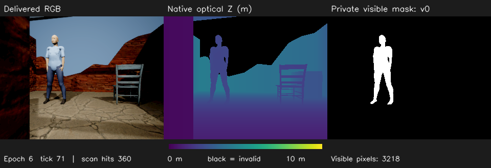

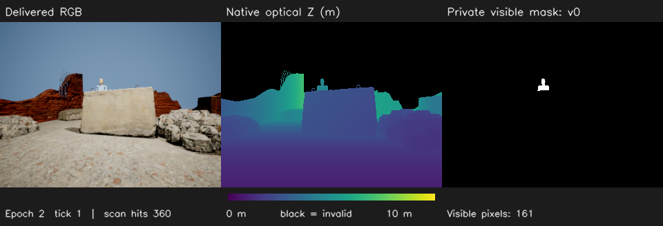

| Cảnh | Kiểm 3 baseline × 3 tư thế, mỗi episode 4 ticks, 640×480, 720 rays |
| --- | --- |
| Indoor | 9 episode, 0 TP, 0 FP. Tường ngăn che mục tiêu từ điểm xuất phát trong cửa sổ ngắn. |
| Outdoor | 9 episode, 2 TP, 0 FP. Frontier và core định vị được người đứng, sai số XY lần lượt 0,067 và 0,057 m. Verify không có report đúng. Cả ba baseline đều bỏ sót người ngồi và nằm trong cửa sổ này. |

Trong ảnh calibration gần ở 640×480, YOLO cho một person box ở cả 6 góc sáng bình thường. Ở low-light, detector có box cho standing ở cả hai cảnh và seated indoor, bỏ sót seated outdoor và cả hai góc prone. Đây là inference trên ảnh UE gốc ở góc đặt trước. Chỉ bảng episode ở trên dùng report đã đi qua tracking, localization và scoring. [Episode summary](evidence/s4-assets/final-poses-summary.json), [frame index và detector outputs](evidence/s4-assets/final-poses-frames/index.json).

Ảnh seated của lượt trên cho thấy lưng ghế ở phía trước người. Lượt kiểm lại đặt ghế theo yaw của nạn nhân, đưa lưng ghế về sau và seat về dưới hông/đùi. Ở cùng góc calibration, mask có 13.921 pixel indoor, 12.552 pixel outdoor, YOLO có box ở cả bốn góc seated clean/low-light. Hai episode frontier 4 ticks vẫn không có report đúng. [Ảnh trước khi sửa](evidence/s4-assets/final-poses-frames/qa-02-indoor-seated-P0-native.png), [ảnh outdoor sau sửa](evidence/s4-assets/continuation/seated-alignment-frames/qa-08-outdoor-seated-P0-native.png), [frame index mới](evidence/s4-assets/continuation/seated-alignment-frames/index.json), [audit](evidence/s4-assets/continuation/seated-alignment-final-audit.json).

## Performance và giới hạn

[Hardware observed](evidence/s4-assets/hardware-observed.json): i5-1135G7, Iris Xe, khoảng 7,65 GiB RAM usable. `AdapterRAM=128 MiB` là trường WMI, không phải tổng shared GPU budget. [Runtime environment](evidence/s4-assets/runtime-environment.json): UE Python 3.11.8, NumPy 2.2.6, OpenCV 4.11.0; packages ở cache riêng. T1 lỗi thiếu PyYAML/import order được giữ, không sửa T1; full run nạp OpenCV trước discovery đạt 239 PASS.

FPS trong index là **engine callback frames / wall time**, cap 10; không phải GPU profiler FPS hoặc sensor Hz. UE working set/private commit được lấy bằng native process counters mỗi giây; không gồm runner, policy hoặc toàn bộ shared GPU allocation. Task clock 2 Hz không chứng minh wall-time real-time 2 Hz. Số đo cuối của từng run nằm trong frame index, `runtime-memory.json` và summary cùng source snapshot; không gộp throughput của QA tĩnh với closed-loop search.

| Run (gồm cả calibration) | Native captures | Callback FPS | UE peak working set (GiB) | UE max private commit (GiB) |
| --- | ---: | ---: | ---: | ---: |
| [Legacy comparison](evidence/s4-assets/legacy-comparison-frames/index.json) | 31 | 9,37 | 1,40 | 2,74 |
| [Hai cảnh, 3 tư thế, 3 baseline](evidence/s4-assets/final-poses-frames/index.json) | 131 | 9,30 | 1,62 | 3,11 |
| [Search trước khi đóng lối ra phía tây](evidence/s4-assets/search-open-90s-frames/index.json) | 429 | 9,26 | 1,13 | 2,93 |
| [Search với lối vào bị sập](evidence/s4-assets/search-closed-90s-frames/index.json) | 317 | 9,53 | 1,35 | 3,16 |
| [Outdoor dùng native geometry](evidence/s4-assets/continuation/outdoor-native-frames/index.json) | 178 | 8,76 | 0,96 | 3,02 |

Riêng trong cửa sổ từ capture đầu tới capture cuối của từng episode, 9 lượt indoor 640×480 đạt 9,38 callback FPS và private commit lớn nhất lấy mẫu là 2,78 GiB; 9 lượt outdoor đạt 9,45 và 2,83 GiB. Indoor search 180 captures mất 411,657 s wall time, 9,57 callback FPS. Outdoor native 116 captures mất 309,718 s, 9,21 callback FPS. Số liệu từng scene gồm cả số mẫu working set, private commit và khoảng thời gian, loại các bước setup, admission và calibration. [Số đo từng cảnh](evidence/s4-assets/scene-performance.json).

Chưa nghiệm thu 300 s/10 Hz, D3D12/Lumen, cross-machine determinism, empirical Astra/G4/encoder/IMU, JetAuto roller/contact/slip/braking hoặc robot thực. Graphics workstation và diverse licensed scan-quality humans/environments vẫn cần để đánh giá fidelity cao hơn. Không publication-ready, không đủ cơ sở S5 confirmatory experiments.
