# S4.5 · Văn phòng hư hại và depot công nghiệp

Ảnh của dự án trong báo cáo lấy từ UE 5.6.1 trên Intel Iris Xe. Ảnh robot là RGB đã giao cho policy. Ảnh overview và close-up do camera QA riêng chụp. Lượt kiểm tra tư thế dùng camera riêng và ground truth để chọn góc. Việc quyết định hai cảnh có đủ chất lượng làm chuẩn cho đợt mở rộng thuộc về người duyệt.

## Đối chiếu nguồn tham khảo

RescueBench chọn bảy môi trường UnrealZoo, đặt điểm xuất phát và nạn nhân trên vùng có thể đi, rồi kiểm tra điều kiện khoảng cách, che khuất và độ khó. Trong bản demo FlexibleRoom, băng ca, xe và người nằm giúp đọc kích thước căn phòng, dù tường và sàn khá đơn giản. Trong Downtown West, khi camera đổi hướng, cây, mép vỉa hè, thùng rác, ô tô và khối nhà có chuyển động tương đối theo khoảng cách. Bóng cây cắt qua cả đường và vỉa hè. Hai ví dụ có độ phức tạp thị giác rất khác nhau ngay trong cùng benchmark. [Bài báo, §2.3 và Hình 3](https://arxiv.org/html/2606.01848v1) · [Kho demo chính thức](https://github.com/UnrealZoo/RescueBench#demo--qualitative-examples)

UnrealZoo dùng các level do nghệ sĩ dựng từ Marketplace. Gallery phân biệt nội thất, công trình và khu đô thị, có hạng mục Industrial Hangar, ChemicalFactory và Abandoned District. Tỷ lệ nhịp kết cấu, cửa thực sự có chiều sâu, chuyển tiếp giữa các khu chức năng và bóng đổ trên vật liệu khác nhau là những đặc điểm có thể kiểm tra từ góc robot. Bài báo còn đo thời gian giao tiếp và các lệnh render riêng; số FPS của hệ thống đó không thể chuyển trực tiếp sang máy Iris Xe. Các nhân vật chuyển động của UnrealZoo cho phép đánh giá theo dõi, trong khi nhiệm vụ S4.5 dùng nạn nhân đứng, ngồi và nằm tĩnh để giữ cố định anchor torso. [Bài báo ICCV](https://openaccess.thecvf.com/content/ICCV2025/html/Zhong_UnrealZoo_Enriching_Photo-realistic_Virtual_Worlds_for_Embodied_AI_ICCV_2025_paper.html) · [Scene Gallery](https://unrealzoo.site/doc/scene-gallery/) · [Trang dự án và video](https://unrealzoo.site/) · [Gym chính thức](https://github.com/UnrealZoo/unrealzoo-gym)

### Hai góc quan sát bên cạnh demo chính thức

| Cảnh | Robot S4.5 | Demo do nhóm RescueBench công bố |
| --- | --- | --- |
| Trong nhà | 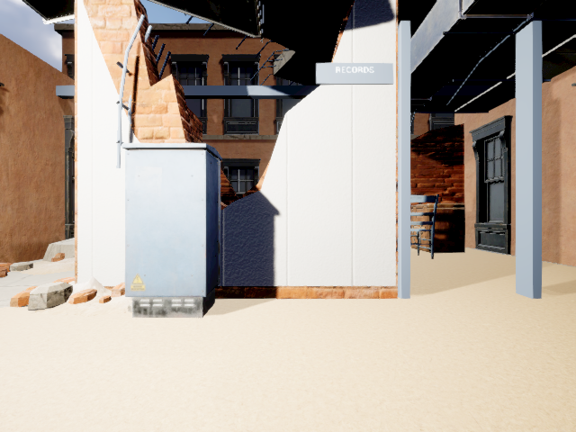 |  |
| Ngoài trời | 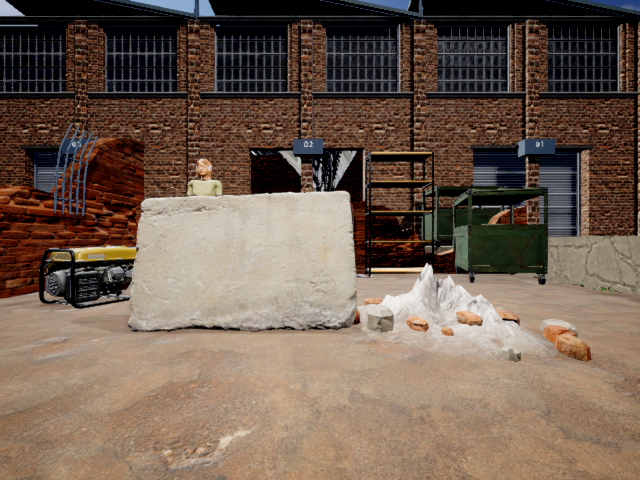 |  |

Hai cột khác độ cao camera, trường nhìn, loại công trình, thời tiết và nhiệm vụ. Cột phải dùng GIF gốc của tác giả và cần kết nối mạng. FlexibleRoom cho thấy rõ khoảng sàn quanh nạn nhân nằm, còn camera S4.5 phải nhìn qua vách hoặc qua vai thiết bị. Downtown West có chiều sâu và biến thiên bóng trên đường rõ hơn depot. Các góc này cho phép thảo luận về bố cục và khả năng đọc cảnh, chưa đủ để xếp hạng độ chân thực giữa hai benchmark.

## Những lỗi phát hiện qua ảnh thật

| Góc kiểm | Lượt nhập đầu | Sau lần sửa thứ nhất |
| --- | --- | --- |
| Ngoài văn phòng | 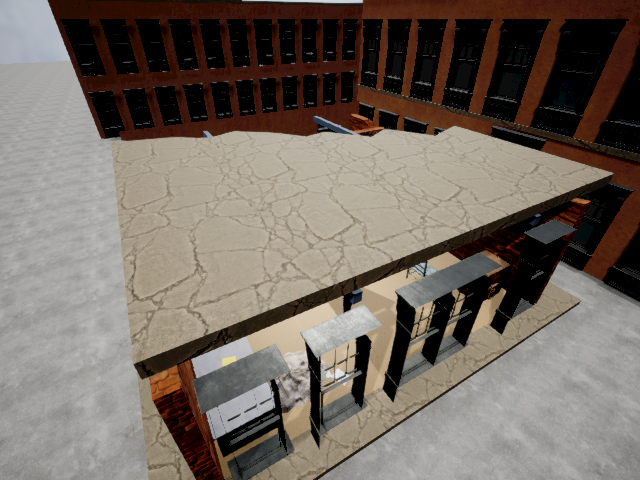 | 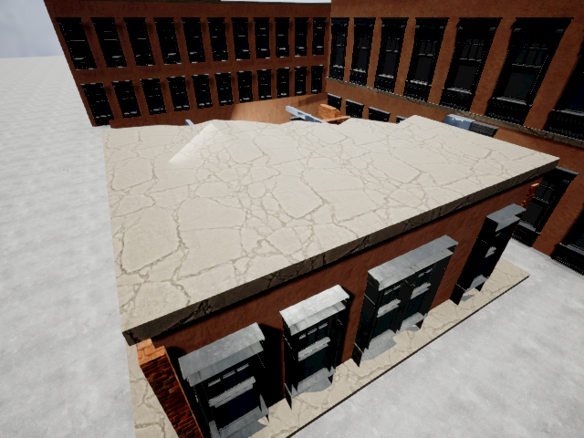 |
| Dưới trần | 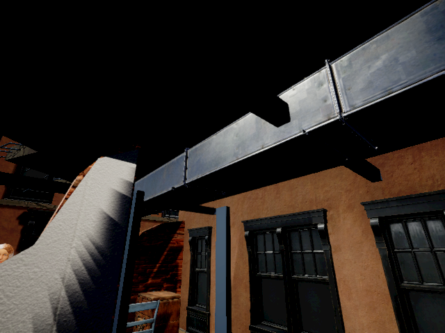 | 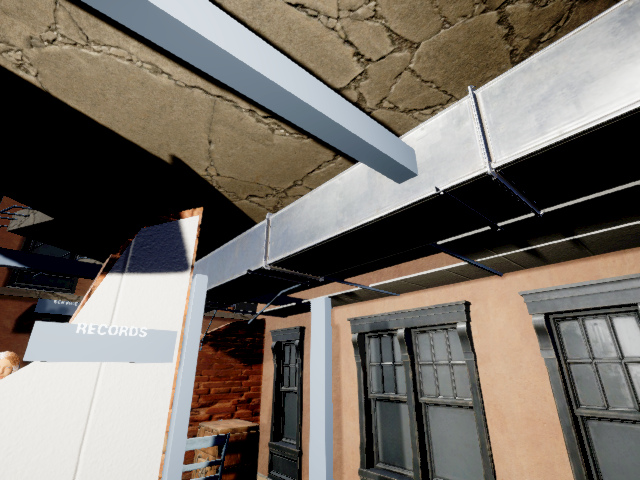 |
| Sân kho | 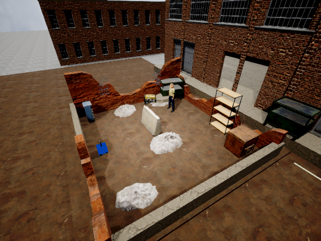 | 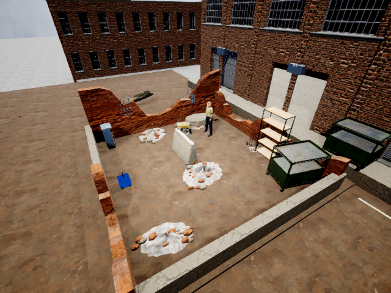 |

Ở lượt đầu, tick 0 trong văn phòng còn hiện ô xám của vật liệu chờ biên dịch. Sau đó UE đã hiển thị vữa tường và thiết bị ở cùng vị trí. Lượt sau chờ trình biên dịch asset trước khi giao ảnh, làm vật liệu mặt đứng hai mặt, di chuyển xe đẩy và đặt máy phát trên sàn trống. Ảnh sau lần sửa thứ nhất còn cho thấy rìa các đống vữa sáng có đường viền rõ và khoảng trống lớn ngoài khu xưởng. Những điểm này dẫn đến thay đổi vật liệu ở mép đổ nát và bổ sung dải cây có hình học thật ở trung cảnh. [RGB đầu tiên](evidence/s45/first-look/frames/e000-robot.png) · [RGB cuối episode đó](evidence/s45/first-look/frames/e000-last-robot.png)

## Cùng một góc máy qua hai lần dựng

Hai cột dùng frame đầu của episode clean, tư thế đứng. Ảnh robot giữ nguyên độ phân giải 640 × 480 và camera quang học cao 0,65 m. Các góc toàn cảnh dùng camera riêng của host. Có thể mở từng ảnh ở kích thước gốc. [Thông số camera của từng cặp](evidence/s45/matched-views.json)

| Góc chụp | S4 đã nghiệm thu | S4.5 |
| --- | --- | --- |
| Văn phòng, robot xuất phát | 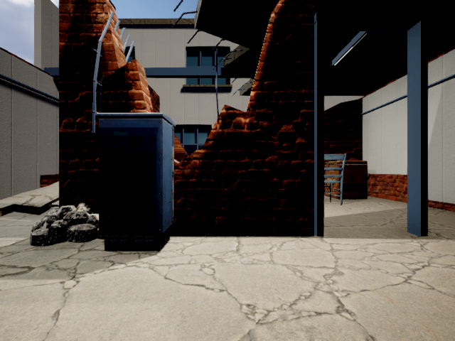 |  |
| Văn phòng, toàn cảnh | 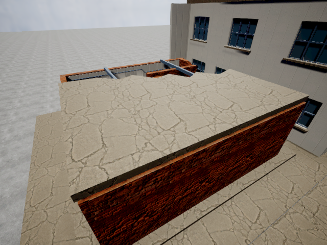 | 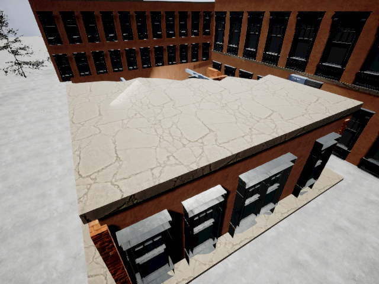 |
| Depot, robot xuất phát | 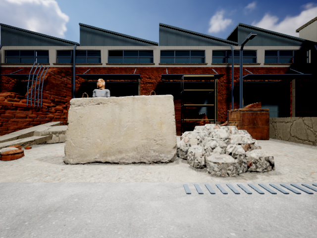 |  |
| Depot, toàn cảnh | 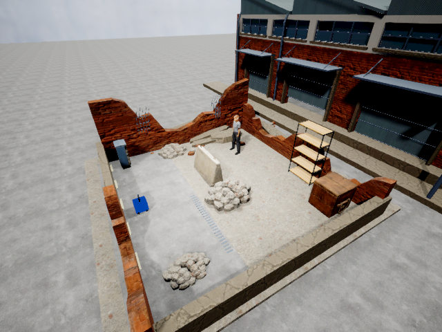 | 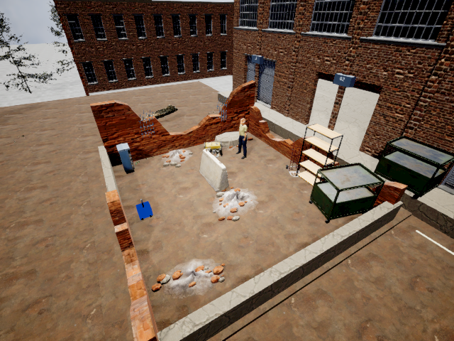 |

## Đi qua hai hiện trường

Mỗi video Frontier đã được giải mã và kiểm đủ 60 frame RGB giao cho policy, từ tick 0 đến 59. Video dài 30 giây, chạy theo đồng hồ nhiệm vụ ở 2 FPS. File MJPEG dùng để xem chuyển động; PNG và hash trong ledger dùng để đối chiếu byte gốc. Camera khảo sát có thể nhìn vào phần kiến trúc nằm ngoài phạm vi hành động của robot.

| Hiện trường | Video camera robot | Góc khảo sát bổ sung |
| --- | --- | --- |
| Văn phòng | [Tải AVI](evidence/s45/search/e000-video/robot.avi) · [Danh sách frame](evidence/s45/search/e000-video/video.json) | [Nhìn từ phía mái gãy](evidence/s45/poses/frames/overview-breach.png) · [Trần và ống gió](evidence/s45/poses/frames/overview-detail.png) · [Bàn làm việc](evidence/s45/poses/frames/overview-workstation.png) |
| Depot | [Tải AVI](evidence/s45/search/e003-video/robot.avi) · [Danh sách frame](evidence/s45/search/e003-video/video.json) | [Nhìn từ phía đối diện](evidence/s45/poses/frames/e001-overview-breach.png) · [Cận cảnh nhà kho](evidence/s45/poses/frames/e001-overview-detail.png) · [Khu thiết bị](evidence/s45/poses/frames/e001-overview-workstation.png) |

| RGB thật trong active search, 320 × 240 | Bằng chứng đi kèm báo cáo Frontier | Khung cuối giao cho policy |
| --- | --- | --- |
| Văn phòng | 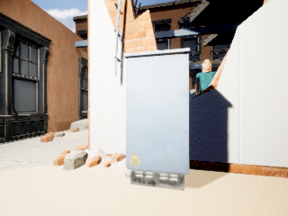 | 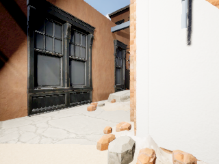 |
| Depot | 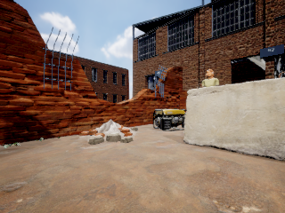 | 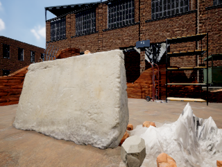 |

| Cảnh và ánh sáng | Đứng | Ngồi | Nằm |
| --- | --- | --- | --- |
| Văn phòng P0 | [RGB](evidence/s45/poses/frames/qa-00-indoor-standing-P0-native.png) | [RGB](evidence/s45/poses/frames/qa-02-indoor-seated-P0-native.png) | [RGB](evidence/s45/poses/frames/qa-04-indoor-prone-P0-native.png) |
| Văn phòng P1 | [RGB](evidence/s45/poses/frames/qa-01-indoor-standing-P1-native.png) | [RGB](evidence/s45/poses/frames/qa-03-indoor-seated-P1-native.png) | [RGB](evidence/s45/poses/frames/qa-05-indoor-prone-P1-native.png) |
| Depot P0 | [RGB](evidence/s45/poses/frames/qa-06-outdoor-standing-P0-native.png) | [RGB](evidence/s45/poses/frames/qa-08-outdoor-seated-P0-native.png) | [RGB](evidence/s45/poses/frames/qa-10-outdoor-prone-P0-native.png) |
| Depot P1 | [RGB](evidence/s45/poses/frames/qa-07-outdoor-standing-P1-native.png) | [RGB](evidence/s45/poses/frames/qa-09-outdoor-seated-P1-native.png) | [RGB](evidence/s45/poses/frames/qa-11-outdoor-prone-P1-native.png) |

Mỗi ảnh tư thế có bản depth 16-bit theo milimét và mask phần nạn nhân thực sự nhìn thấy ở cùng góc. [Thư mục frame và metadata](evidence/s45/poses/frames/)

Đo riêng trên 12 ảnh QA 640 × 480, YOLO xuất một box người ở 11 góc. Góc bị bỏ sót là nạn nhân ngồi trong văn phòng thiếu sáng, dù mask có 15.128 pixel. Ở tư thế này, mặt và cánh tay bắt được chút ánh sáng, còn áo gần như hòa vào nền. Phép đo detector ngoại tuyến này giải thích một giới hạn của hình ảnh; kết quả định vị chính thức dùng báo cáo của policy trong episode. [RGB](evidence/s45/poses/frames/qa-03-indoor-seated-P1-native.png) · [Mask](evidence/s45/poses/frames/qa-03-indoor-seated-P1-v0-visible.png) · [Depth](evidence/s45/poses/frames/qa-03-indoor-seated-P1-depth-mm.png) · [Box của từng ảnh](evidence/s45/poses/frames/index.json)

### Những chi tiết còn thấy rõ ở tầm robot

Trong văn phòng, mặt bích trên ống sáng và các đoạn trần còn sót giúp xác định hướng sập. Ở góc bàn làm việc có thể phân biệt bàn phím, tờ giấy và bề dày vách gãy. Từ trên mái, phiến trần lớn còn phẳng và hàng cửa sổ lặp rất đều. Trong vùng tối, đường viền cổ áo và cánh tay dễ mất vào hậu cảnh. Các tư thế dùng mesh cố định; quần áo chưa có nếp gấp biến dạng khi cơ thể tì lên ghế hoặc sàn.

Ở depot, có thể nhìn qua cửa bay 02 đến giàn cầu trục và đọc được khoảng cách giữa tường gạch, khung cửa, máy phát và người. Cốt thép lộ trong tường nối vị trí đổ nát với vùng sập. Nhìn toàn sân vẫn thấy một số đống vỡ tách thành từng cụm sáng và màu gạch trên mép gãy có tỷ lệ lớn hơn gạch của nhà kho. Ra ngoài dãy nhà, nền và đường chân trời còn thiếu chi tiết của một khu công nghiệp hoàn chỉnh.

## Phiếu duyệt của người xem

Với từng hàng, ghi điểm 1–5 cho từng cảnh và tên frame hoặc timestamp làm căn cứ. **1** là chi tiết sai tỷ lệ, sai vị trí hoặc phá vỡ cảm giác không gian. **3** là nhận ra chức năng từ nhiều góc nhưng còn lỗi rõ. **5** là chi tiết giữ được tính thuyết phục khi robot đến gần, quay đầu và khi ánh sáng thay đổi. Không gộp các tiêu chí thành một kết quả duy nhất.

| Tiêu chí | Điều cần xem trực tiếp |
| --- | --- |
| Kiến trúc và tỷ lệ | Cửa, ngưỡng, bàn, người và dock có cùng thước đo; nhìn qua cửa đọc được khoang kế tiếp |
| Hình học | Cạnh vỡ, độ dày tường, khe giữa ống gió và giá đỡ, hình dạng cầu trục khi đổi góc |
| Vật liệu | Hướng vân, tỷ lệ viên gạch, mối nối, độ nhám của thép và sự tiếp giáp giữa bụi và nền |
| Ánh sáng | Độ rõ trong vùng dưới mái, bóng chạm đất, highlight trên kim loại và clipping khi người bị ngược sáng |
| Bố cục | Có tiền cảnh, trung cảnh, hậu cảnh; hai hướng tiếp cận cho thấy các phần khác nhau của công trình |
| Tính hợp lý sau thiên tai | Vị trí mảnh vỡ tương ứng vùng gãy, thiết bị có điểm tựa, lối đi có lý do tồn tại |
| Nạn nhân | Đọc được tư thế và giải phẫu ở tầm máy thấp; kiểm tiếp xúc sàn/ghế, nếp vải, tóc và che khuất qua depth/mask |

**Trạng thái duyệt thị giác: chờ người duyệt.** [Audit kỹ thuật](s45-audit.md)
