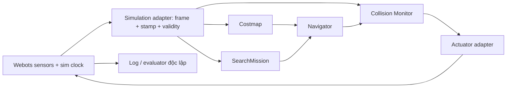

# S0 — Simulator Feasibility

> Cập nhật sau S0: xem [S1 — Webots PoC Hardening](webots-s1-audit.md) cho fixture initial pose đã guard, logs reset/reload và ca occlusion chạy thật ngày 2026-11-25. Các mục UNVERIFIED lịch sử bên dưới giữ nguyên theo thời điểm S0; kết quả S1 và giới hạn hiện hành được ghi riêng trong báo cáo mới.

Ngày khảo sát: **2026-11-25**. Repository: `innguyen/Robotic`, nhánh `feat/benchmark`.
Mốc source được đọc: `57ab7e65fcfbac9d573321feb2e5afdccbf5f6d7`.
Đối tượng trình bày: giảng viên hướng dẫn; quyết định cần chốt là có đầu tư tích hợp simulator 3D hay không.

## 1. Đề xuất và trạng thái bằng chứng

**GO có giới hạn cho PoC Webots R2025a trên laptop hiện tại.** Chức năng tìm–tiếp cận–dừng đã có log thực chạy; người dùng đánh giá mượt và ổn định, đồng thời yêu cầu dừng đo RAM/FPS chi tiết để tiết kiệm thời gian. Chưa nghiệm thu hiệu năng định lượng hoặc cảnh lớn. Chọn R2025a để khớp hướng dẫn IEEE SMCS SAR 2026. P2.3 tạm hoãn; T1 và các kết quả benchmark giữ nguyên.

| Nội dung | Trạng thái S0 hiện tại |
| --- | --- |
| Khảo sát tài liệu chính thức, đọc interface lõi trong repository | Đã thực hiện |
| Thiết kế adapter và chuẩn bị world/controller độc lập | Đã chuẩn bị; chưa tích hợp production |
| Cài Webots và khởi tạo graphics | Người dùng đã mở demo Moose bằng R2025a; CLI `--sysinfo` xác nhận Iris Xe/OpenGL 4.6; xem preflight ở mục 10 |
| World S0 mở/render | Đã thấy trong ảnh thực chạy do người dùng cung cấp; vật lý bánh xe chưa được kiểm chuẩn |
| Python và sensor S0 | Console xác nhận `python.exe -u s0_smoke.py`, START, scan/camera hợp lệ và trạng thái APPROACH; bằng chứng sơ bộ ở mục 10 |
| Hoàn tất nhiệm vụ | Lượt đầu có ảnh FOUND; log gốc lượt chạy lại xác nhận SEARCH_SPIN → APPROACH → FOUND tại 20.544 s và SAMPLE vẫn FOUND tại 26.112 s |
| FPS, RAM và độ ổn định định lượng | **UNVERIFIED — dừng đo thêm theo yêu cầu người dùng; không chặn GO giới hạn** |
| RAM snapshot người dùng cung cấp | Available **876 MB**, dưới ngưỡng G3 tham khảo 1 GB tại thời điểm chụp; giữ số liệu, không yêu cầu đo lại |
| H200/MIG render sensor | Chưa chạy; không mặc định là phương án rendering |
| Quyết định triển khai tiếp | **GO có giới hạn cho PoC cảnh nhỏ**, theo phạm vi cập nhật tại mục 8 |

Không suy ra PASS từ thông số CPU/RAM, video demo của bên khác, kiểm tra cú pháp Python hay mock API. S0 xác minh công cụ và luồng dữ liệu; không chứng minh thuật toán tìm kiếm tốt hơn, độ chính xác YOLO, tính chân thực địa hình hoặc sim-to-real.

## 2. Phần cứng và rủi ro chính

Máy đích do người dùng cung cấp: Windows 11, Intel Core i5-1135G7, RAM 8 GB, Intel Iris Xe Graphics. GPU tích hợp dùng chung bộ nhớ hệ thống nên cần đo cả RAM khả dụng toàn máy. Preflight CLI đã xác nhận Intel Iris Xe với OpenGL `4.6.0 - Build 31.0.101.5186`; ảnh chạy world S0 có số liệu RTF/sensor ban đầu, chưa có phép đo FPS/RAM và cửa sổ nghiệm thu đầy đủ.

Webots công bố Windows 10/11 64-bit và OpenGL tối thiểu 3.3; hãng ưu tiên NVIDIA/AMD và cảnh báo GPU Intel có thể gặp lỗi rendering/crash. Cập nhật driver có thể giúp nhưng không bảo đảm. Đây là **rủi ro cần thử sớm**, không phải kết luận Iris Xe chắc chắn thất bại. [Yêu cầu chính thức](https://github.com/cyberbotics/webots/blob/R2025a/docs/guide/system-requirements.md).

Camera và LiDAR Webots dùng rendering; riêng LiDAR lấy khoảng cách từ OpenGL depth rendering. Tắt cửa sổ 3D bằng `--no-rendering` không loại nhu cầu render sensor. [LiDAR API](https://github.com/cyberbotics/webots/blob/R2025a/docs/reference/lidar.md), [CLI](https://github.com/cyberbotics/webots/blob/R2025a/docs/guide/starting-webots.md).

Server H200/MIG phù hợp để cân nhắc inference/training AI riêng sau S0. Theo NVIDIA, H200 có MIG nhưng graphics API không được hỗ trợ trong MIG của GPU này; ngoại lệ `+gfx` được liệt kê cho một số dòng GPU khác. `nvidia-smi` hoặc CUDA chạy được không chứng minh camera/LiDAR render được. Không tự đổi MIG mode hay cấu hình server trường. Nếu sau này được cấp tài nguyên graphics khác, cần xác minh driver, profile, OpenGL/EGL context và chạy chính sensor scene trước. Xvfb chỉ cung cấp display ảo; không tự tạo GPU graphics acceleration. [GPU hỗ trợ MIG](https://docs.nvidia.com/datacenter/tesla/mig-user-guide/latest/supported-gpus.html), [Giới hạn graphics](https://docs.nvidia.com/datacenter/tesla/mig-user-guide/latest/deployment-considerations.html).

## 3. So sánh phương án với ưu tiên tiết kiệm thời gian

**Robotics simulator** cung cấp mô hình robot, actuator, sensor, thời gian mô phỏng và API điều khiển phục vụ robotics. **Game engine** cung cấp scene/rendering/physics chung; vẫn có thể làm robotics nhưng nhóm phải bổ sung và kiểm chứng sensor, frame, robot control và bridge. Chất lượng đồ họa cao không đồng nghĩa với sensor hoặc động học đúng.

Các nhận định về chi phí dưới đây là đánh giá kỹ thuật theo phạm vi dự án, không phải số đo trên máy đích.

| Công cụ | Loại và khả năng liên quan | Đánh giá cho S0 trên máy 8 GB |
| --- | --- | --- |
| **Webots** | Robotics simulator; camera/LiDAR, joint/motor, Python controller, Supervisor. Có ví dụ SAR phù hợp. | **Thử đầu tiên**. Ít phần phải tự xây; rủi ro chính là Intel/OpenGL. Dùng cảnh primitive nhỏ. |
| **CoppeliaSim** | Robotics simulator; dynamics, collision, vision/proximity sensor; Python script hoặc ZeroMQ remote API có stepping. | Dự phòng robotics nếu cần vật lý và Webots thất bại. Edu chỉ dành cho đối tượng trường học/đại học theo điều khoản hãng; kiểm license model/plugin riêng. Chưa có bằng chứng nhẹ hơn Webots trên Iris Xe; không cài song song lúc này. |
| **Godot** | Game engine; có 3D physics và Compatibility renderer cho phần cứng tích hợp; Python không phải ngôn ngữ chính thức tích hợp sẵn. | Có thể dùng cho demo hình học nhẹ qua GDScript + cầu nối Python, nhưng phải tự làm scan, đồng bộ và robot model. Chỉ cân nhắc nếu mục tiêu chuyển thành demo 3D, không coi là robotics simulator tương đương. |
| **Unity** | Game engine; scene/physics phong phú, có hệ sinh thái robotics; phải chọn và kiểm bridge/sensor packages, thường làm scene bằng C#. | Editor khuyến nghị tối thiểu 8 GB RAM, chiếm gần ngân sách RAM máy. Tốn công tích hợp so với nhiệm vụ nhỏ; không ưu tiên. |
| **Unreal Engine** | Game engine thiên về rendering; cần lớp robotics và sensor/control riêng hoặc plugin phù hợp. | Epic khuyến nghị 32 GB RAM và 8 GB graphics RAM. Không phù hợp ưu tiên thời gian và cấu hình này; loại khỏi S0. Đây không phải khẳng định engine không thể khởi động. |

Nguồn: [Webots](https://github.com/cyberbotics/webots), [CoppeliaSim](https://www.coppeliarobotics.com/), [ZeroMQ stepping](https://manual.coppeliarobotics.com/en/zmqRemoteApiOverview.htm), [license CoppeliaSim](https://www.coppeliarobotics.com/downloads), [Godot requirements](https://docs.godotengine.org/en/stable/about/system_requirements.html), [Godot languages](https://docs.godotengine.org/en/stable/about/faq.html#which-programming-languages-are-supported-in-godot), [Unity 6 requirements](https://docs.unity3d.com/6000.0/Documentation/Manual/system-requirements.html), [Unreal requirements](https://dev.epicgames.com/documentation/en-us/unreal-engine/hardware-and-software-specifications-for-unreal-engine).

### Tham khảo IEEE SMCS Search and Rescue Competition 2026

[Trang IEEE chính thức](https://www.ieeesmc.org/2026-sar-competition/) xác nhận Phase 1 dùng Webots cho đội UGV tìm nạn nhân. [Repository Phase 1](https://github.com/IEEE-SMCS/2026-ieee-smcs-competition-phase-1) hướng dẫn Webots R2025a, Python từ 3.10, Git LFS và world `worlds/basic_example.wbt`; có RGB/depth, LiDAR và ví dụ Python.

S0 kế thừa **ý tưởng**: robot đọc sensor, tìm người, tiếp cận rồi báo tìm thấy. Không sao chép toàn bộ challenge: bỏ đội hai robot, video flyover, communication/scoring server và map lớn. Không dùng điểm thi làm metric T1. Scene cuộc thi chỉ là bước tham khảo tùy chọn sau khi scene nhỏ PASS.

Không vendor asset cuộc thi trong PoC này. Nếu dùng sau: pin commit, kiểm Git LFS đã lấy dữ liệu thật, kiểm license từng asset/PROTO; MIT ở cấp repository có ngoại lệ cho file mang license khác. [LICENSE](https://github.com/IEEE-SMCS/2026-ieee-smcs-competition-phase-1/blob/main/LICENSE.txt). Không coi chữ “open-source” là giấy phép chung cho mọi model.

## 4. PoC nhỏ nhất đã chuẩn bị

Hai file, độc lập với production:

- [World `s0_search.wbt`](../experiments/webots_s0/worlds/s0_search.wbt).
- [Python controller `s0_smoke.py`](../experiments/webots_s0/controllers/s0_smoke/s0_smoke.py).

| Thành phần | Thiết kế |
| --- | --- |
| Môi trường | Sàn 8 × 6 m, bốn tường, một hộp vật cản; native nodes, không mesh/texture tải mạng |
| UGV | Hai bánh chủ động + hai caster, bán kính bánh 0.10 m, track 0.36 m; có mass/joint/boundingObject |
| Người | Một mannequin từ box/sphere, có collision shape và nhãn `s0_person`; không animation |
| Camera | RGB 160 × 120, FOV ngang 58°, period 96 ms; `Recognition` bật occlusion mức 1 |
| LiDAR | Một layer, 180 rays, 360°, range 0.05–6 m, period 96 ms; không point cloud |
| Clock | Physics 32 ms; control/sensor 96 ms, khoảng 10.42 Hz theo simulation time |
| Nhiệm vụ | Khởi đầu quay lệch hướng người; xoay tìm → xác nhận hai mẫu liên tiếp → tiếp cận → dừng ở range phẳng camera–tâm người ≤ 0.8 m |
| Bảo vệ demo | Không tiến nếu sensor sai; phía trước < 0.45 m thì dừng tiến; timeout 90 s simulation time; không nối robot thật |
| Output | JSON lines `START`, `STATE`, `FOUND`, `SAMPLE`; giữ log cả khi timeout/lỗi |

Baseline đặt hộp lệch đường tiếp cận để kiểm luồng camera–Python–motor trước. Đây là bài tìm một người ban đầu ngoài FOV, chưa phải tìm đường qua vật cản hoặc tìm người bị che kín. Bước kiểm occlusion/obstacle ở mục 7 tách riêng để phân biệt vấn đề sensor với giới hạn policy demo.

**Recognition là oracle của simulator**, cung cấp semantic label và vị trí tương đối camera, không phải YOLO hoặc nhận diện ảnh thật. Bật occlusion không làm nó trở thành detector thực. Chỉ dùng để loại chi phí AI khỏi phép thử tính khả thi. [Camera recognition API](https://github.com/cyberbotics/webots/blob/R2025a/docs/reference/camera.md), [giới hạn occlusion](https://github.com/cyberbotics/webots/blob/R2025a/docs/reference/recognition.md).

Mẫu không import SearchMission/Navigator/Monitor. Bộ dừng khoảng cách trong demo chưa phải Collision Monitor đã có. UGV vi sai tiết kiệm công dựng, nhưng **không đại diện động học Mecanum JetAuto**. World load/render và controller đọc sensor đã có bằng chứng thực chạy sơ bộ; hướng motor, caster/ma sát, quy ước sensor và mission hoàn tất chưa được nghiệm thu đầy đủ.

## 5. Kiến trúc tái sử dụng qua simulation adapter

Các thành phần có thể import trực tiếp mà không chạy ROS node:

| Thành phần hiện tại | Interface đã đọc | Trách nhiệm adapter dự kiến |
| --- | --- | --- |
| [`SearchMission`](../test%20version/search_core_ros1.py) | `SearchMission(nav, cfg)`, `update_coverage(...)`, `step(pose, target, standoff, now, dt)` | Chuyển detection mới sang `(x,y)` trong odom; không có detection hợp lệ thì `None`; giữ state machine tìm kiếm |
| [`Navigator`, `Costmap`](../test%20version/navigation_core_ros1.py) | `Navigator(cfg, collision_cfg, async_planning=...)`, `costmap.update(...)`, `snapshot(...)`; command `(vx,vy,wz)` | Cung cấp pose/scan đồng bộ; giữ planner và controller hiện tại |
| [`Monitor`, `scan_points`](../test%20version/collision_monitor_ros1.py) | `scan_points(...)`, `set_scan(points, now)`, `invalidate_scan(reason)`, `set_command(..., now)`, `evaluate(now)` | Chuyển scan đúng frame, kiểm freshness; chỉ gửi command đã qua Monitor tới actuator |
| [`simulate_navigation.py`](../test%20version/simulate_navigation.py) | `observe()`/`step()` minh họa thứ tự cập nhật lõi | Tham khảo cách nối lõi, thay raycast/Euler 2D bằng sensor/actuator Webots |
| [`navigation_ros1.py`](../test%20version/navigation_ros1.py) | `MONITOR_OK`, gate, standoff người 0.55 m | Tham khảo điều kiện gate và timeout; không chạy `main()`/ROS bridge trong S0 |



Lớp adapter đặt ở `experiments/` khi được quyết định tích hợp, giữ core nguyên trạng. Không cần ROS/WSL/Docker cho PoC. Luồng dự kiến, **chưa phải mã tích hợp đã chạy**:

```python
obs = sim.read()  # sim time, pose, scan, camera/detection, validity + stamps
# Nếu pose/scan không hợp lệ hoặc stale: invalidate + zero; không step mission.
nav.costmap.update(obs.ranges, obs.angle_min, obs.angle_increment,
                   obs.range_min, obs.range_max, obs.pose, obs.scan_stamp)
mission.update_coverage(obs.ranges, obs.angle_min, obs.angle_increment,
                        obs.range_min, obs.pose)
nav.grid = nav.costmap.snapshot(obs.pose, obs.now)
monitor.set_scan(scan_points(obs.ranges, obs.angle_min, obs.angle_increment,
                            obs.range_min, obs.range_max, cc), obs.scan_stamp)
# Áp dụng gate như navigation_ros1 trước khi cho mission tiếp tục.
raw, reason = mission.step(obs.pose, obs.fresh_target_or_none, 0.55,
                           obs.now, obs.dt)
monitor.set_command(*raw, now=obs.now)
checked, monitor_state = monitor.evaluate(obs.now)
sim.apply_body_velocity(checked)  # tuyệt đối không dùng raw ở đây
```

Hợp đồng cần kiểm trước khi tích hợp:

1. **Frame và đơn vị:** world ENU, mét/radian/giây; body `+x` tiến, `+y` trái, `+wz` ngược chiều kim đồng hồ. Chọn odom origin ở pose ban đầu, không lẫn world position với odom. Có thể bắt đầu bằng pose GPS/IMU lý tưởng hoặc Supervisor lấy **pose robot** và phải ghi `ideal_pose`; không lấy vị trí người toàn cục để cấp target cho policy.
2. **LiDAR:** Webots trả rays trái→phải; core nhận `angle_min + i*angle_increment`. Đảo thứ tự và xác minh góc bằng hộp đặt ở trước/trái/phải; tránh trùng tia ±π với scan 360°. Không đoán endpoint chỉ từ số rays. Cấu hình scan extrinsic của fixture là `(0.12,0,0)` theo body; không dùng mù quáng YAML robot có `scan_x=0.096` và blind sectors khác. Giữ `+Inf` cho no-return, NaN/zero/negative là unknown/invalid; lỗi chuyển đổi phải invalidate scan và zero, không biến dữ liệu lỗi thành khoảng trống.
3. **Camera:** chuyển vector camera→base→odom bằng extrinsic và pose cùng stamp; chuẩn hóa camera FOV/range với SearchConfig. Recognition adapter là oracle có nhãn rõ; detector RGB thật + range/depth là công việc riêng sau GO. Không coi `update_coverage` (ước lượng từ LiDAR) là pixel visibility ground truth.
4. **Clock:** tất cả timeout/coverage/Monitor dùng simulation time; `perf_counter` chỉ đo hiệu năng. Khi reset world phải tạo lại mission/nav/monitor và lịch sử; khi pause không tăng tuổi dữ liệu theo wall time. Scan thiếu không được cập nhật timestamp giả; stale scan/odom/target phải có ca kiểm riêng.
5. **Động học:** Navigator hiện là holonomic và có thể xuất `vy != 0`. Chỉ dùng nguyên lệnh với model Mecanum/omni được kiểm chứng. Không âm thầm đặt `vy=0` trên UGV vi sai. Nếu chọn vi sai, cần adapter điều khiển nonholonomic có thiết kế/kiểm tra riêng; đổi đường đi cần Monitor đánh giá **lại command thực sẽ chạy**. Bước tích hợp ưu tiên model omni có sẵn hoặc kinematic omni được ghi rõ giới hạn, không tự viết động lực học Mecanum trong S0.
6. **Safety và planner:** giữ gate theo trạng thái Monitor, ghi raw/checked/applied; stale/invalid phải dừng. Không bypass Monitor để demo chạy. Không tạm dừng simulation clock để chờ planner worker rồi báo RTF tốt hơn; ghi thời gian planner, cleanup bằng `nav.close()` khi kết thúc.

GO phần công cụ không tự động là GO tái sử dụng nguyên trạng controller JetAuto. Cần một ca adapter chạy `vx`, `vy`, `wz`, kiểm frame/timeout/Monitor trước khi gọi đó là tích hợp thành công.

## 6. Checklist cài đặt trên laptop

Timebox đề xuất: 30–45 phút cài/driver, 30 phút smoke, tối đa 30 phút thử profile giảm tải và chẩn đoán. Không dành nhiều ngày sửa engine trước khi báo lại giảng viên; thời gian tải mạng ghi riêng.

- [ ] Cắm nguồn, tắt ứng dụng nặng; ghi Windows build, CPU/RAM, driver Iris Xe và RAM khả dụng trước test. Không nâng cấp driver nếu máy đang ổn chỉ để đủ checklist; nếu lỗi rendering thì thử driver OEM/Intel chính thức một lần và ghi phiên bản trước/sau.
- [ ] Tải installer Windows x64 **R2025a** từ [release chính thức](https://github.com/cyberbotics/webots/releases/tag/R2025a); không build Webots từ source.
- [ ] Kiểm Python 64-bit bằng `py -0p`. Dùng Python có sẵn tương thích từ 3.10; nếu API/DLL lỗi, thử 3.11 x64 trong venv riêng thay vì sửa môi trường production.
- [ ] Tạo venv riêng cho S0. Controller mẫu chỉ dùng standard library và API đi kèm Webots; **không `pip install controller`**. Chưa cần numpy, torch, YOLO, ROS hoặc Git LFS cho world native này.

```powershell
Set-Location 'C:\Projects\Robotic'
py -3 -m venv experiments/webots_s0/.venv
& '.\experiments\webots_s0\.venv\Scripts\python.exe' -c 'import sys; print(sys.version); print(sys.maxsize > 2**32)'
```

- [ ] Trong Webots `Tools > Preferences > General > Python command`, trỏ đến đường dẫn tuyệt đối `C:/Projects/Robotic/experiments/webots_s0/.venv/Scripts/python.exe`. Không cần activate venv để Webots dùng đúng interpreter. [Python setup](https://github.com/cyberbotics/webots/blob/R2025a/docs/guide/using-python.md).
- [ ] Trong Preferences/OpenGL: tắt shadows, ambient occlusion và anti-aliasing, texture low; giữ main 3D view bật. Dùng cửa sổ khoảng 960 × 600, ghi kích thước viewport và display scaling thực. [Preferences](https://github.com/cyberbotics/webots/blob/R2025a/docs/guide/preferences.md).
- [ ] Mở `experiments/webots_s0/worlds/s0_search.wbt`, dừng ở t=0; xác nhận world không báo parse/missing device/PROTO errors. World này không cần asset pack mạng.
- [ ] Kiểm `WorldInfo.basicTimeStep=32`, `FPS=30`; chạy **Real-time**, không Fast/minimize. Trần `FPS=30` là cấu hình, chưa phải FPS đo được.

Có thể thu thông tin và log qua CLI sau khi đóng instance Webots đang mở; sửa đường dẫn executable nếu cài nơi khác:

```powershell
$s0WebotsExe = 'C:\Program Files\Webots\msys64\mingw64\bin\webots.exe'
$s0Evidence = Join-Path (Get-Location) 'experiments\webots_s0\evidence\run-01'
New-Item -ItemType Directory -Force -Path $s0Evidence | Out-Null
& $s0WebotsExe --sysinfo 2>&1 | Out-File (Join-Path $s0Evidence 'sysinfo.txt')
& $s0WebotsExe --mode=realtime --stdout --stderr '.\experiments\webots_s0\worlds\s0_search.wbt' 2>&1 |
    Tee-Object -FilePath (Join-Path $s0Evidence 'console.txt')
```

Đây là hướng dẫn để người dùng chạy. Sau đợt chuẩn bị tài liệu, người dùng đã cài Webots và cung cấp ảnh chạy world S0 với Python controller; xem kết quả sơ bộ ở mục 10. Không chạy controller bằng `python s0_smoke.py` ngoài Webots rồi coi lỗi thiếu `controller` là lỗi phần cứng.

## 7. Smoke test và cách ghi số liệu

### 7.1 Trình tự chức năng

1. **Open/reload:** mở world, nhìn thấy sàn/tường, UGV, hộp và người; reset/reload hai lần, không parse errors/crash. Ghi thời gian mở lần đầu và lần cache riêng. Nếu góc nhìn bất tiện, chọn robot rồi dùng chức năng đưa viewpoint về đối tượng trong GUI; ghi lại thay đổi.
2. **Python/motor:** console có `START` và `STATE`; robot thực sự xoay tại chỗ rồi tiến khi thấy người. Nếu quay/lùi sai hướng, dừng và kiểm sign/joint axis trước. Log command không thay thế quan sát chuyển động thật. Reset phải đưa robot về vị trí ban đầu và khởi tạo lại controller.
3. **Sensor:** `camera_bytes=76800`, `rays=180`; có finite ranges trong phòng, no-return `+Inf` được phép. Bật camera overlay, xem người/hộp đúng hướng; ảnh phải thay đổi khi robot xoay, scan thay đổi khi di chuyển hộp. Không coi buffer đúng độ dài nhưng ảnh đen/đóng băng là PASS.
4. **Tìm người:** baseline phải có `SEARCH_SPIN → APPROACH → FOUND` trước 90 s simulation time, sau đó motor dừng và robot đứng yên ít nhất 5 s. Thực hiện hai lượt reset độc lập; lưu cả lượt thất bại. Timeout chỉ là timeout của demo, không tự quy lỗi GPU.
5. **Vật cản/occlusion:** trong bản sao world, đặt hộp tại `(0.3,-1,0.6)` trên đường UGV–người. Xác nhận scan thấy hộp, camera recognition không thấy tâm người khi bị che, robot không tiến xuyên hộp. Mẫu có thể dừng hoặc timeout vì không có planner vòng tránh; không bắt buộc FOUND ở biến thể này. Nếu cần kiểm riêng dừng tiến, đặt hộp trước robot khi đang approach và quan sát `OBSTACLE_STOP`. Không dùng fixture này để tuyên bố Collision Monitor production đã PASS.

### 7.2 Đo hiệu năng

Mỗi profile: warm-up 30 s wall time, đo 120 s wall time không pause/đổi focus/minimize. Có thể reset nhiệm vụ rồi warm-up lại để đo đoạn đang chuyển động; log rõ đoạn FOUND đứng yên. Khi FOUND sớm, vẫn để chạy đọc sensor đủ cửa sổ đo; không chỉ lấy số lúc đứng yên làm đại diện chạy tìm kiếm. Ghi hai lượt baseline; không trộn các profile vào một trung bình.

| Chỉ số | Cách lấy | Lưu ý |
| --- | --- | --- |
| RTF | Mỗi `SAMPLE`: Δsimulation time / Δ`perf_counter` trong cửa sổ khoảng 5 s wall | Gần 1 ở Real-time; không phải FPS; bỏ các cửa sổ warm-up/pause |
| Sensor samples/s wall | `valid_sensor_samples_per_wall_s` | Đếm chu kỳ controller đọc mẫu hợp lệ ở cùng period sensor; kỳ vọng khoảng 10.42 ở RTF=1. Không phải phép đo GUI FPS, cũng không tự phát hiện buffer bị đóng băng |
| GUI FPS thực | Capture process render Webots bằng Intel PresentMon, xuất CSV, chọn đúng process/viewport swapchain và khoảng 120 s | Tải từ [dự án Intel chính thức](https://github.com/GameTechDev/PresentMon); dùng help/UI của bản cài. OpenGL có giới hạn telemetry; nếu không bắt được frame stream thì ghi UNVERIFIED, không lấy refresh rate màn hình hoặc `WorldInfo.FPS` thay thế |
| FPS tổng hợp | Số frame intervals hợp lệ / tổng interval seconds; lưu median và p95 frame time nếu có | Không tính trung bình các giá trị `1000/frame_ms` để thay FPS tổng hợp; loại khoảng warm-up/pause theo mốc đã ghi |
| RAM process | Task Manager/Resource Monitor: Webots và Python controller; ghi working set và private/commit peak riêng | Không cộng private bytes với working set thành “RAM”; integrated GPU shared memory có thể ảnh hưởng toàn máy |
| RAM toàn máy | Available RAM tối thiểu và committed memory peak trong Resource Monitor/Task Manager; lấy mẫu khoảng 1 s | Ghi nền trước test, paging/đơ; đừng suy RAM khả dụng từ tổng working set process |
| Load/stability | Đồng hồ wall, console errors, crash/hang count, ảnh chụp viewport/camera | Load asset lần đầu tách khỏi throughput ổn định |

Phần đo định lượng ở mục này được giữ làm hướng dẫn tham khảo. Theo quyết định cập nhật của người dùng tại mục 8, không yêu cầu cài PresentMon, đo lại RAM hoặc chạy thêm cửa sổ hiệu năng để chốt GO giới hạn. Các phép đo chưa thực hiện vẫn UNVERIFIED.

Profile A là cấu hình mẫu. Nếu lỗi/chậm, chỉ thử **một** profile B: camera 80 × 60, LiDAR 90 rays, period giữ 96 ms, main view nhỏ hơn và trần 20 FPS; vẫn giữ camera/LiDAR/control hoạt động. Ghi diff world và sửa kỳ vọng thành `camera_bytes=19200`, `rays=90`. Tắt sensor hoặc chỉ mở cảnh rỗng không được coi là profile B đạt nhiệm vụ.

## 8. Cổng GO / NO-GO

### Quyết định đang áp dụng: GO giới hạn, ưu tiên thời gian

Ngày 2026-11-25, sau khi xem kết quả PoC và snapshot RAM, **người dùng yêu cầu không tiếp tục quy trình đo RAM/FPS chi tiết**, chấp nhận trải nghiệm mượt và ổn định để quyết định tính khả thi ban đầu. Đây là thay đổi phạm vi đánh giá sau quan sát, không phải tuyên bố các ngưỡng định lượng ban đầu đã PASS.

- **GO cho PoC nhỏ:** world mở/render, Python đọc camera/LiDAR, hoàn tất tìm–tiếp cận–dừng có log; người dùng đánh giá sử dụng mượt, ổn định. Bằng chứng hiện có đáp ứng phạm vi này.
- **NO-GO trong phạm vi này:** lỗi graphics, crash/hang lặp lại hoặc sensor/control không hoạt động khiến demo cơ bản không dùng được. Chẩn đoán lỗi fixture/controller trước khi quy kết phần cứng; dùng fallback mục 9 nếu không giải quyết được trong timebox.
- **Giới hạn:** chưa có FPS thực, RAM peak/min và stress test; snapshot Available 876 MB vẫn được giữ nguyên. Ca hộp/occlusion chưa nghiệm thu, model vi sai chưa đại diện Mecanum, recognition là oracle. Các mục này không được gắn PASS và không chặn quyết định tiếp tục phát triển PoC nhỏ theo yêu cầu mới.
- **Không yêu cầu thêm thao tác người dùng** để đóng ứng dụng nền, đo RAM/FPS, lấy lại log lượt đầu hay chạy đủ cửa sổ 120 s trong đợt S0 này. Khi mở rộng quy mô hoặc cần công bố hiệu năng, xem xét lại protocol riêng.

### Ngưỡng định lượng ban đầu — giữ làm tham khảo

Bảng G1–G5 dưới đây là đề xuất ban đầu, **không phải điều kiện bắt buộc của quyết định GO giới hạn hiện tại** và chưa được nghiệm thu đầy đủ. Đây là ngưỡng nội bộ, không phải cam kết từ hãng hoặc chuẩn IEEE.

| Cổng | Điều kiện GO trên cùng profile A hoặc B | Nếu không đạt |
| --- | --- | --- |
| G1 — Load/stability | Mở ≤ 60 s sau cài đặt/cache; hai lượt 120 s không crash, render lỗi hoặc hang > 5 s | Chẩn đoán parser/driver/controller trước; chưa phân loại được thì PENDING |
| G2 — Rendering/clock | FPS GUI tổng hợp ≥ 15, p95 frame time ≤ 100 ms; median RTF ≥ 0.8 và không có cửa sổ 5 s nào RTF < 0.5 sau warm-up | Thử profile B một lần; thiếu phép đo FPS thì PENDING |
| G3 — Memory | Toàn máy còn ≥ 1 GB available trong cửa sổ đo, không paging gây đơ liên tục; ghi peak Webots/Python | Nếu hụt sau đóng app nền/profile B: NO-GO laptop với cấu hình này |
| G4 — Sensor/control | Camera và scan đúng kích thước, thay đổi đúng cảnh, không lỗi sensor; Python thực sự điều khiển; ≥ 8 valid sensor samples/s wall trung vị và không khoảng mất dữ liệu > 0.5 s simulation time | Sensor/adapter lỗi phải sửa trước; không giảm tiêu chí bằng cách bỏ sensor |
| G5 — Mission | Hai lượt baseline đạt FOUND < 90 s simulation time, dừng; ca hộp không tiến xuyên vật cản | Tách lỗi policy/physics khỏi hiệu năng, sửa trong timebox rồi thử lại |

**Nghiệm thu định lượng mở rộng:** chỉ khi sau này chọn thực hiện đủ G1–G5 và thu đủ raw logs/CSV mới gọi là đạt bộ ngưỡng này. GO giới hạn hiện tại không chứng minh map thi đấu/YOLO/multi-robot khả thi.

**UNVERIFIED cho chỉ số:** giữ nhãn này khi chưa chạy hoặc thiếu bằng chứng; không đồng nghĩa toàn bộ quyết định GO giới hạn phải PENDING. Không đồng nhất lỗi world/controller với phần cứng NO-GO.

Nếu sau này mở rộng và gặp lỗi graphics/crash, thiếu RAM gây không sử dụng được hoặc sensor/control không đáp ứng nhiệm vụ, chẩn đoán một lần và thử profile B trong timebox rồi quyết định lại. Lưu lỗi và phạm vi thất bại; snapshot RAM đơn lẻ dưới ngưỡng tham khảo không tự đảo quyết định GO hiện tại.

**Cổng tích hợp sau S0:** khi triển khai adapter, vẫn cần kiểm frame/góc scan, odom sync, reset, stale/invalid stop và ánh xạ đủ `(vx,vy,wz)` qua Monitor trên model thích hợp. Chưa gọi là tái sử dụng SearchMission thành công trước khi thực hiện phần tích hợp này; đây là công việc sau S0.

## 9. Fallback và công việc tiếp theo

1. **Fallback tối thiểu ngay lập tức:** dùng mô phỏng 2D đã có trong `test version/SIMULATION.md`, scenario `search`, để trình luồng SearchMission–Navigator–Monitor. Không viết lại benchmark T1, không đổi metric/corpus và không gọi đó là chứng minh RGB/LiDAR 3D. Việc 2D chạy được trên laptop cũng cần xác minh riêng, không tự PASS.
2. Nếu giảng viên bắt buộc demo 3D: đề nghị một máy có GPU graphics được hỗ trợ để chạy **cùng Webots PoC** trước, giữ laptop làm client. Server H200/MIG hiện tại không được coi là máy graphics sẵn có.
3. Nếu bắt buộc đổi công cụ: chỉ chọn **CoppeliaSim** cho lượt feasibility kế tiếp khi vẫn cần robotics physics/Python, hoặc **Godot Compatibility** nếu chấp nhận demo hình học 3D và chi phí tự xây sensor/bridge. Chốt một mục tiêu rồi mới triển khai một công cụ; cả hai đều chưa được kiểm trên laptop. Unity/Unreal không nằm trong fallback tối thiểu.

Sau GO, ưu tiên một adapter sensor/clock/Monitor + model omni đủ lệnh, rồi mới nối SearchMission và detector. Không triển khai ba simulator cùng lúc, không tái xây T1 và không sửa production trong S0. P2.3 chỉ tiếp tục khi người dùng quyết định mở lại; xem [kế hoạch đang tạm hoãn](benchmark-p23-plan.md).

## 10. Kiểm tra artifact trong đợt chuẩn bị

Các ghi nhận bên dưới giữ lịch sử bằng chứng và những mục chưa xác minh. Các trạng thái PENDING hoặc yêu cầu đo thêm ghi ở thời điểm trước được thay thế bởi quyết định GO giới hạn tại mục 8; số liệu gốc không thay đổi.

- Đã kiểm `git diff --check`; không có lỗi whitespace.
- Đã dùng Node.js kiểm cân bằng dấu ngoặc world, các tham chiếu `DEF`/`USE`, tên device/controller và toàn bộ link file nội bộ trong báo cáo: đạt. Đây chỉ là kiểm cấu trúc tĩnh, không phải parser Webots.
- Ở lần chuẩn bị, kiểm Python qua launcher `py` thất bại vì không tìm thấy `C:\Python313\python.exe`. Ảnh smoke sau đó xác nhận Webots chạy được controller qua `python.exe`; lỗi launcher `py` không đồng nghĩa interpreter Webots bị lỗi. Chưa chạy kiểm logic tự động riêng.
- Tại lần chuẩn bị ban đầu, chưa tìm thấy Webots ở hai đường dẫn cài phổ biến đã kiểm. Trạng thái này đã được cập nhật bởi preflight và ảnh smoke bên dưới; chưa có bộ raw logs và số đo nghiệm thu đầy đủ.
- Thay đổi chỉ gồm báo cáo, dòng trạng thái tạm hoãn P2.3 và hai file PoC trong `experiments/`; source production và benchmark T1 không đổi.

### Preflight sau khi người dùng cài Webots — 2026-11-25

- Ảnh do người dùng cung cấp cho thấy Webots **R2025a** đã mở/render world `moose_demo.wbt`. Chỉ số tức thời `0.46x` trên ảnh là hệ số tốc độ mô phỏng, không phải FPS; không dùng demo khác làm kết quả G1–G5 của S0.
- Đã thực chạy `webots.exe --sysinfo`: Windows 11 Version 26H2 64-bit, i5-1135G7, 4 cores, OpenGL vendor Intel, renderer Iris Xe, OpenGL `4.6.0 - Build 31.0.101.5186`. Log: [sysinfo.txt](../experiments/webots_s0/evidence/preflight-2026-11-25/sysinfo.txt). Khởi tạo được graphics context là bằng chứng ban đầu, không bảo đảm sensor/performance của PoC đạt.
- Đã thử lại `py -3 --version`: thất bại vì không tìm thấy `C:\Python313\python.exe`. Log: [python-check.txt](../experiments/webots_s0/evidence/preflight-2026-11-25/python-check.txt). Chưa có interpreter hoạt động được xác minh qua launcher này; nếu đã cài Python ở nơi khác, chọn đường dẫn thực đó trong Webots Preferences.
- Computer Use không kết nối được native pipe (`The system cannot find the file specified`, os error 2), vẫn lỗi sau retry và reset session. Chưa thao tác đổi world hoặc cấu hình Python qua GUI; đây là lỗi công cụ điều khiển của phiên làm việc, không phải lỗi Webots hay GPU.
- Tại thời điểm preflight chưa chạy world S0. Bằng chứng smoke mới hơn được ghi bên dưới; không dùng lỗi `py` để yêu cầu cài lại Python khi controller trong Webots đã chạy được.

### Smoke S0 đang chạy — ảnh người dùng cung cấp

Nguồn bằng chứng: ảnh trong hội thoại, title `s0_search.wbt (webots_s0) — Webots R2025a`, simulation time khoảng 14.848 s. Chưa có file console đầy đủ hoặc ảnh được lưu thành artifact trong repository; không suy diễn phần chạy ngoài ảnh.

- World đã mở/render UGV, người và hộp; camera overlay đang hiện người.
- Console ghi `Starting controller: python.exe -u s0_smoke.py`, sau đó `START` với camera `[160,120]`, period 96 ms và 180 rays. Như vậy cấu hình `Python command = python` đang hoạt động cho controller này; chưa xác định version/path/bitness cụ thể của interpreter.
- State ban đầu `SEARCH_SPIN` tại 0.096 s, chuyển `APPROACH` tại 3.456 s. Ba dòng SAMPLE hiển thị đều có `valid_sensor=true`, `camera_bytes=76800`, `rays=180` và `person_visible=true`.

| Simulation time (s) | RTF trong SAMPLE | Valid sensor samples/s wall | Target range (m) |
| --- | --- | --- | --- |
| 4.608 | 0.911 | 9.486 | 2.872 |
| 9.408 | 0.941 | 9.804 | 2.259 |
| 14.112 | 0.929 | 9.678 | 1.653 |

Các giá trị được đọc và làm tròn từ ảnh. Khoảng cách giảm phù hợp với giai đoạn tiếp cận, nhưng chưa thay thế kiểm chuyển động/động học trực tiếp. Chỉ số toolbar `0.96x` là tốc độ tức thời; không phải FPS. Ba SAMPLE thuộc đoạn đầu, chưa đủ warm-up/cửa sổ 120 s để chốt G2/G4. Recognition vẫn là oracle của simulator.

### Cập nhật: ảnh trạng thái FOUND

Ảnh tiếp theo do người dùng cung cấp có simulation time khoảng 227.456 s; các SAMPLE hiện trên console tại 189.888–223.488 s đều mang `state=FOUND`, `valid_sensor=true`, `person_visible=true`, camera 76800 bytes, 180 rays (178 finite). LiDAR minimum/front minimum giữ nguyên khoảng 0.889615 m qua đoạn 33.6 s simulation time, phù hợp với robot đã đứng yên; đây chưa thay thế phép đo pose/velocity thực. RTF đọc từ các dòng hiện có khoảng 0.93–0.96, thuộc giai đoạn FOUND, không đại diện cho toàn lượt tìm kiếm.

Controller giữ lệnh motor bằng 0 khi FOUND nhưng vẫn gọi `robot.step()` và đọc/log sensor để thu hiệu năng. Đồng hồ Webots và SAMPLE tiếp tục là hành vi dự kiến, không có nghĩa robot tiếp tục được lệnh di chuyển. `target_range_m=null` sau FOUND do mẫu không tính lại biến range ở nhánh kết thúc.

Đã có bằng chứng controller đạt FOUND ở lượt này. Chưa có dòng `event=FOUND` đầu tiên để ghi chính xác thời gian tìm thấy, chưa có raw console đầy đủ, lượt lặp, ca hộp hoặc FPS/RAM theo protocol. **Quyết định vẫn PENDING.**

Kiểm RAM toàn máy qua `Get-CimInstance Win32_OperatingSystem` tại phiên shell bị `Access denied`; các giá trị 0 phát sinh từ truy vấn lỗi bị loại, không phải RAM thực tế. Một snapshot working set của process không xác minh peak hoặc RAM available tối thiểu. Cần ghi Task Manager/Resource Monitor trong cửa sổ đo của lượt chạy tiếp theo.

**Bước tiếp theo:** lưu console lượt hiện tại trước khi reset, chạy lại baseline và quan sát dừng, ghi RAM; sau đó kiểm ca hộp và đo FPS theo mục 7. Không cần đổi/cài lại Python chỉ vì launcher `py` của phiên shell lỗi.

### Kiểm lượt 2: world đã lưu pose cuối, cần chạy lại baseline

Người dùng báo đã lưu/reset/chạy lượt 2. Ảnh cho thấy `event=FOUND` tại **0.192 s**, camera planar range **0.792604 m**, command `[0,0,0]`. Đây là bằng chứng nhánh dừng hoạt động khi bắt đầu gần người, **chưa được tính là lượt lặp toàn nhiệm vụ tìm kiếm**.

Đã đọc file world thực tế và thấy robot được lưu tại `(-0.088722,-1.008309,0.099405)`, yaw khoảng `0.007632` rad, thay vì pose xuất phát `(-2,-1,0.1)`, yaw `-π/2`. World còn chứa joint positions và velocities của trạng thái cuối. Vì vậy reload file đã lưu cũng khởi đầu gần người; chỉ đưa đồng hồ về 0 chưa bảo đảm reset đúng fixture.

Đã giữ nguyên bản world đó tại [saved-pose-before-repeat-fix.wbt](../experiments/webots_s0/evidence/saved-pose-before-repeat-fix.wbt), SHA256 `7d9e024841edaf20bc8f585de9dab927d75ad07010877e24b4efdcc12dde8357`. Sau đó khôi phục pose robot, bánh/caster và bỏ joint positions/velocities đã lưu trong `s0_search.wbt`. Giữ viewpoint, môi trường và các cấu hình khác do người dùng lưu; không sửa controller hay production. Kết quả chạy lại sau sửa được ghi bên dưới.

Để chạy lượt lặp: pause, reload world từ đĩa; nếu được hỏi lưu scene đang mở thì không ghi scene cũ đè lên file vừa sửa. Ở t=0 kiểm robot đứng xa người khoảng 3 m, quay lệch hướng; chạy lại phải có `SEARCH_SPIN → APPROACH → FOUND`. Lưu **nội dung console** vào file evidence riêng. Lưu world trong khi robot đã tới đích có thể thay pose khởi đầu của lượt sau. RAM/FPS và ca hộp vẫn chờ kiểm.

### Lượt chạy lại từ pose đã khôi phục: hoàn tất tìm kiếm và giữ dừng

Ảnh người dùng cho thấy t=0 robot ở xa người. Đã đọc và kiểm tra trực tiếp [run-02-console.txt](../experiments/webots_s0/evidence/run-02-console.txt), xác nhận chuỗi sau:

| Sự kiện | Simulation time (s) | Bằng chứng trong log gốc |
| --- | --- | --- |
| SEARCH_SPIN | 0.096 | Command `[0,0,0.35]` |
| APPROACH | 3.456 | Bắt đầu tiếp cận; các SAMPLE sau có range giảm khoảng 2.850 → 2.247 → 1.628 → 1.004 m |
| FOUND | 20.544 | Camera planar range `0.7924920292840374` m; STATE có command `[0,0,0]` |
| SAMPLE vẫn FOUND | 26.112 | Sensor hợp lệ, LiDAR minimum khoảng 0.889615 m; hơn 5.568 s simulation time sau FOUND |

Đã parse thành công 11 JSON events và kiểm chuỗi STATE, range FOUND ≤ 0.8 m, command cuối `[0,0,0]`, SAMPLE cuối vẫn FOUND sau 5.568 s. Cả 6 SAMPLE đều có `valid_sensor=true`, camera 76800 bytes và 180 rays. Kiểm tra đạt đối với **các dữ liệu được log**, không xác minh được mọi chu kỳ sensor giữa các SAMPLE hoặc pose/velocity thực. Lượt 0.192 s từ pose cuối vẫn bị loại khỏi repeat baseline. Log gốc lượt đầu chưa được cung cấp.

Trung vị trên riêng 4 SAMPLE APPROACH: RTF **0.939295**, valid sensor samples/s wall **9.784324**. Đây là thống kê mô tả đoạn khởi động ngắn, chưa phải kết quả G2/G4 theo cửa sổ warm-up + 120 s. Không gộp với giai đoạn FOUND hoặc cửa sổ pause.

Các SAMPLE APPROACH trong ảnh có RTF khoảng 0.932–0.947 và valid sensor samples/s wall khoảng 9.71–9.87. SAMPLE tại 21.408 s có RTF khoảng 0.064 và sensor samples/s wall khoảng 0.665; cửa sổ này đi qua lần pause được thấy ở ảnh trước (t=21.344 s), nên không dùng làm bằng chứng engine chậm. Mẫu tiếp theo tại 26.112 s trở lại RTF khoảng 0.939. Khi tính hiệu năng chính thức phải đánh dấu và loại cửa sổ có pause theo protocol; chưa có số tổng hợp đủ warm-up/120 s và chưa đo GUI FPS.

### RAM và trải nghiệm người dùng — snapshot Task Manager

Người dùng cung cấp ảnh Task Manager > Performance > Memory, với Webots mở phía sau, và nhận xét khi sử dụng Webots khá mượt, không thấy giật/lag đáng kể.

| Trường trên ảnh | Giá trị |
| --- | --- |
| RAM lắp đặt / usable | 8.0 GB / khoảng 7.7 GB |
| In use | 6.8 GB (88%); compressed 1.2 GB |
| Available | **876 MB** |
| Committed | 15.0 / 23.6 GB |
| Cached | 752 MB |

Đây là số liệu **toàn máy tại một thời điểm**, không phải RAM riêng Webots hay peak/min theo cửa sổ nghiệm thu. Commit không tương đương RAM vật lý đang dùng; chưa có dữ liệu để quy mức dùng bộ nhớ cho Webots hoặc kết luận paging gây lag. Chưa xác nhận thời điểm chụp là Real-time đang tiến hay pause.

Available 876 MB thấp hơn ngưỡng G3 ≥ 1 GB đã đề xuất, nên **chưa đạt G3 tham khảo tại snapshot này**. Theo yêu cầu mới của người dùng ở mục 8, dừng đo thêm và không yêu cầu đóng ứng dụng nền. Không sửa số đo hoặc gắn PASS cho G3; GO giới hạn dùng phạm vi chức năng/trải nghiệm đã được chấp nhận riêng.

Nhận xét chạy mượt được ghi là **quan sát định tính do người dùng báo**, phù hợp với tín hiệu RTF sơ bộ; không chuyển thành FPS đo được hoặc PASS hiệu năng. GUI FPS và cửa sổ ổn định không pause chưa xác minh; hiện không yêu cầu thực hiện thêm.

## 11. Phiếu kết quả để điền sau chạy thật

Giữ một bản cho mỗi run/profile; không điền số dự đoán. Lưu evidence ở thư mục run riêng ngoài các artifact benchmark T1, kiểm riêng tư trước chia sẻ sysinfo/log.

| Trường | Giá trị hiện tại / cần điền |
| --- | --- |
| Ngày/giờ chạy, người chạy | Người dùng đã chạy và cung cấp ảnh; chưa ghi giờ bắt đầu/kết thúc |
| Windows build, driver Iris Xe, Webots/Python version | Sysinfo ở mục 10; Webots R2025a; Python version chưa xác minh, controller đã chạy |
| Commit + hash world/controller + mọi thay đổi profile | Source đã khảo sát ở đầu báo cáo; hash artifact cần ghi lúc chạy |
| Profile, viewport/scaling, mode, nguồn điện, app nền | Chưa ghi |
| Wall time mở cảnh / lỗi reload | UNVERIFIED |
| Đo warm-up / cửa sổ hoạt động / cửa sổ FOUND | UNVERIFIED |
| FPS GUI, frame time p95, CSV/tool version | UNVERIFIED |
| Median/min window RTF; median sensor samples/s wall | 4 SAMPLE APPROACH trong log lượt 2: median RTF 0.939295, median sensor samples/s wall 9.784324; thống kê theo protocol vẫn UNVERIFIED |
| Peak working set + private/commit của Webots/Python | UNVERIFIED |
| RAM available min / system commit peak / paging | Snapshot: Available 876 MB, Committed 15.0/23.6 GB; G3 tham khảo chưa đạt ở thời điểm chụp; min/peak/paging UNVERIFIED, dừng đo thêm theo yêu cầu |
| RGB thay đổi / scan trước-trái-phải / occlusion | UNVERIFIED |
| Python xoay/tiến/dừng / sensor gap / invalid | UNVERIFIED |
| FOUND và thời gian sim từng lượt / ca hộp / crash | Lượt đầu có FOUND; lượt sau sửa fixture FOUND tại 20.544 s, còn FOUND tại 26.112 s; lượt 0.192 s loại khỏi repeat baseline; ca hộp UNVERIFIED |
| Raw console / sysinfo / screenshots / FPS CSV paths | Có [log gốc lượt 2](../experiments/webots_s0/evidence/run-02-console.txt) và sysinfo; ảnh trong hội thoại; chưa có raw console lượt đầu/FPS CSV |
| Quyết định / G1–G5 | **GO giới hạn cho PoC nhỏ** theo chức năng và trải nghiệm người dùng; bộ G1–G5 định lượng chưa nghiệm thu đủ |

Kết luận để trình giảng viên hiện tại: **GO có giới hạn: Webots khả thi cho PoC cảnh nhỏ trên laptop hiện tại, dựa trên log chức năng tìm–tiếp cận–dừng và trải nghiệm mượt, ổn định do người dùng báo. Theo yêu cầu ưu tiên thời gian, dừng đo RAM/FPS chi tiết. Snapshot RAM 876 MB Available được giữ nguyên; FPS, hiệu năng dài hạn, ca hộp và tích hợp lõi chưa nghiệm thu. Quyết định không mở rộng sang cảnh lớn, YOLO hoặc multi-robot.**
